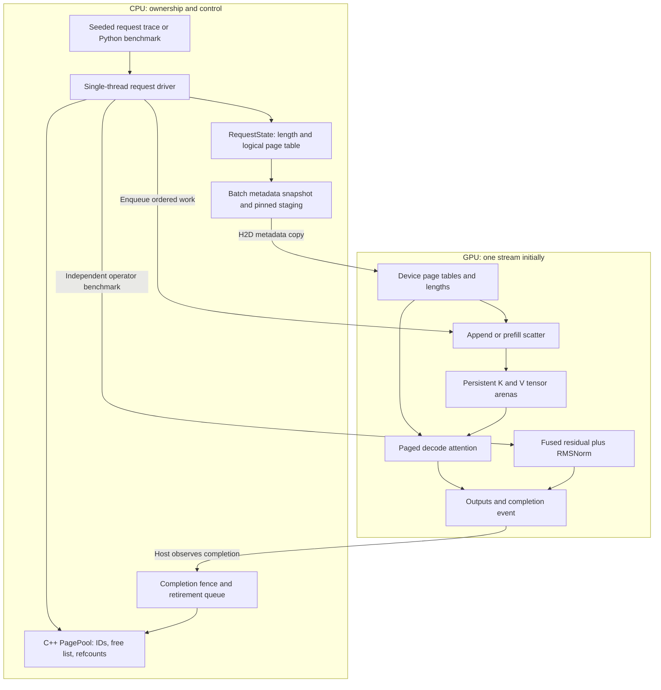

# LLM Kernel Inference: engineering roadmap

Prepared 2026-10-23, America/Los_Angeles. **Status: design baseline. Live implementation status and executed checks are tracked in [README](README.md) and the [engineering log](docs/ENGINEERING_LOG.md); this roadmap itself is not performance evidence.** All effort estimates, experiment sizes, and spending allocations below are planning recommendations. Provider observations are dated in section 8.

This is a build-it-yourself blueprint. Implement the exercises, write down your predictions, and use AI to review invariants, explain profiler evidence, and minimize failing cases. Do not accept code you cannot explain line by line.

## 1. Executive project assessment and feasibility under $100

**Build a measured inference-components laboratory first.** A correct C++ page allocator, fused residual/RMSNorm kernel, and single-layer paged decode kernel form a substantial portfolio project. A useful result may be that paging improves usable capacity while slowing an individual attention operation. Explaining that result is more valuable than selecting a flattering speedup.

The $100 infrastructure ceiling is feasible with local CPU development and short, prepared GPU sessions. It does not purchase the engineering time: plan approximately **140–230 focused hours for the core**, potentially 200–300 for a polished portfolio. A student learning C++ and CUDA simultaneously may need longer. Spend the first week locally. Release only a **$20 all-in first tranche**, including setup, idle GPU time, storage, transfers, and applicable charges. Continue only after the section 9 gates.

Use one NVIDIA GPU, one process, one CPU scheduling thread, one CUDA stream, and one attention layer initially. Start with ordinary FP32 arithmetic and FP16 storage. Aim to understand correctness, byte traffic, and ownership before Tensor Cores, assembly, quantization, or distributed serving.

The major risks are manageable: stale page mappings, incorrect numerical semantics, premature page reuse, and misleading timing. Beating a mature library is not an acceptance criterion. Obtaining reproducible evidence and explaining a regression are acceptance criteria.

Your inspected local environment is an Apple ARM64 Mac with Apple Clang 17, CMake 4.4.4, Ninja 1.13.2, Python 3.14.8, and Xcode selected. These tools were found; no project build has yet been tested. Use the Mac for C++, CPU references, tests, and analysis. CUDA execution and NVIDIA profiling require the remote NVIDIA host. Choose a separate Python 3.11/3.12 environment if the selected GPU image or package wheels require it; do not force the remote environment to match the Mac's Python.

## 2. Project architecture and major component interactions

### 2.1 The system boundary



RMSNorm and attention are complementary benchmark tracks, not automatically a valid transformer block. A real block also needs Q/K/V and output projections, positional encoding, MLPs, and model-specific residual ordering. Do not wire RMSNorm output directly into attention and describe that as an LLM.

The **CPU allocator allocates integer page IDs**, not GPU memory on every request. Allocate the GPU arenas once at startup; a page ID selects an offset. This separation allows almost all allocation policy development without a GPU. Here “page” means a fixed number of token slots, not an operating-system page or CUDA virtual-memory mapping. The paging idea is motivated by [the PagedAttention paper](https://arxiv.org/abs/2309.06180).

### 2.2 Representation: choose clarity first

Notation: `B` active requests, `P` tokens/page, `N` physical pages, `Hq` query heads, `Hkv` KV heads, `D` head dimension, `e` bytes/element, `L` layers. Initially `L=1`, `P=16`, `Hq=Hkv=8`, `D=64 or 128`.

| Object | Initial representation | Ownership and location |
|---|---|---|
| Free pages | Preallocated `vector<PageId>` used as a stack | C++ `PagePool`, CPU |
| Page metadata | Arrays of refcount, state, generation, valid-token count | CPU; generation helps catch stale handles |
| Request | ID, committed length, `vector<PageHandle>` | Move-only CPU `RequestState`; releases references through the scheduler |
| Device table | Dense `int32[B,max_pages]`, unused entries `-1` | GPU metadata owner; stable capacity per benchmark |
| Lengths | `int32[B]`; includes the newly appended token | CPU authoritative, GPU snapshot |
| KV data | Separate contiguous `K[N,Hkv,P,D]`, `V[N,Hkv,P,D]` | GPU tensor owner; dtype FP16 initially |
| Query/output | `Q[B,Hq,D]`, `O[B,Hq,D]` | GPU tensors |
| Metadata staging | Pinned host arrays with explicit lifetime | Kept immutable until async copy completes |
| Completion | Event plus pages/buffers awaiting reuse | CPU driver observes GPU completion |

For token `t`, `logical_page=t/P`, `offset=t%P`, `physical=table[b,logical_page]`. The element offset is:

```text
(((uint64(physical) * Hkv + kv_head) * P + offset) * D + channel)
```

Use checked 64-bit arithmetic for allocation sizes and offsets even though page IDs fit in 32 bits. Reject negative IDs, out-of-range dimensions, unsupported strides, and invalid lengths before launching. For later grouped-query attention, require `Hq % Hkv == 0` and use `kv_head = query_head / (Hq/Hkv)`.

One physical page stores both K and V for `P` tokens across all KV heads in this layer:

```text
bytes_per_page_per_layer = 2 * P * Hkv * D * e
arena_bytes = N * bytes_per_page_per_layer
multi_layer_arena_bytes = L * arena_bytes
```

Example: `P=16,Hkv=8,D=128,e=2` gives 65,536 bytes/page. `N=4096` gives 256 MiB for one layer, or 6 GiB for 24 layers. These are arithmetic examples, not measurements, and exclude weights, tables, activations, temporary buffers, and framework reservations. Always distinguish decimal GB from binary GiB.

Keep an explicit arena owner. For the Python benchmark, allocate persistent CUDA tensors and let a C++ `GpuCache` wrapper retain those tensors. The pure C++ allocator must have no dependency on PyTorch. Kernel wrappers borrow pointers only during enqueued operations. If you later need a standalone executable, substitute an RAII CUDA-buffer owner behind the same view; do not maintain two competing allocation systems initially.

### 2.3 Request flow and synchronization contract

**Synthetic prefill:** allocate `ceil(prompt_length/P)` pages transactionally; generate seeded K/V outside timed attention; scatter valid tokens to physical slots; enqueue metadata upload and scatter in the same stream; publish readiness after that work is ordered. This populates a cache. It does **not** compute transformer prefill.

**One decode step:**

1. Reap completed retired pages and choose active requests.
2. Reserve an additional page if the append crosses a page boundary. Allocation failure must leave the request unchanged.
3. Fill an immutable batch snapshot with physical IDs and the new committed lengths.
4. Upload the snapshot on the chosen stream; enqueue append of the new K/V; enqueue attention reading exactly those lengths. `Q`, new K, and new V are precomputed inputs in the synthetic benchmark.
5. Record completion after every consumer of this step's pages and metadata.
6. In the first implementation, synchronize that stream before any cancellation, reclamation, table reuse, or next step. Later use completion events and a retirement queue to overlap host work safely.

Same-stream ordering makes the new KV visible before attention. It does not make host buffers safe to mutate immediately after an async copy. Nor does a CPU refcount reaching zero imply that the GPU has stopped reading the page. [CUDA asynchronous execution documentation](https://docs.nvidia.com/cuda/cuda-programming-guide/02-basics/asynchronous-execution.html) is the relevant programming contract.

Use page states `Free → Live → Retired → Free`. CPU reference counts track request/table and optional prefix-cache owners. When the last reference disappears, place the page behind a fence covering **all** previously submitted readers; keep it unavailable until completion. In the serialized version, the fence is already complete. For multiple streams later, a single event on an unrelated stream is insufficient: join dependencies or track each reader stream.

Do not destroy the pool while requests or submissions refer to it. Destructors release ownership without throwing; explicit shutdown drains GPU work and surfaces errors. Generation numbers help detect stale CPU handles, but cannot make an already-submitted stale GPU table safe.

### 2.4 Shared prefixes without corrupting requests

Implement refcount operations and tests in Phase 1. Introduce **explicit sharing of complete, immutable pages** before automatic prefix lookup. At `P=16`, two requests sharing the first 32 tokens retain the same first two pages and each owns its writable tail. Their CPU tables are separate even when IDs match.

If a shared prefix ends at token 35, initially share 32 tokens and independently materialize the last 3. Later implement partial-page copy-on-write: allocate a new page, copy only valid K/V for every head (and every layer if applicable), redirect the writing request, then append. Order copying, table publication, and old-page retirement correctly. If allocation fails, do not decrement the old reference or alter the table.

An automatic prefix cache needs its own reference on cached pages and an eviction policy. Equal text is not a sufficient key: model revision, exact token IDs, positional/rotary settings, adapter identity, dtype/layout, and the preceding prefix matter. For the synthetic benchmark, share only identical, deliberately generated prefix data. Hash-based lookup and collision handling are extensions.

### 2.5 Important architectural decisions

| Decision | Recommended starting point and reason | Alternative, cost, and when preferable | Evidence to collect |
|---|---|---|---|
| Allocation | Fixed-size pool, stack free list; bounded work and arbitrary physical IDs | Per-request allocations are simpler but growth/copying and driver/framework overhead complicate latency; variable-sized suballocation may save tails but adds coalescing | Same trace: CPU tails, rejected requests, bytes copied, waste |
| Page size | Start 16, then 8/32/64 | Larger pages reduce table entries and allocation churn; smaller pages reduce tail waste and improve sharing granularity | Fixed-byte-budget utilization/latency frontier |
| Storage | Contiguous physical arena with paged logical sequences | Truly contiguous per-request KV avoids lookup; reserved capacity wastes space, exact growth can copy | Separate attention-only overhead from capacity benefits |
| Layout | K and V `[N,Hkv,P,D]`; `D` contiguous | Packed/transposed K and different V layout may improve transactions, but complicate append and copies | Same data, packing cost, transactions, kernel time |
| Ownership | Single-thread metadata, explicit refcounts for pages | Unique ownership alone is easier; atomics add cost and do not solve GPU lifetime | Share/release stress tests; no synchronization by assumption |
| Kernel language | CUDA C++ is the learning implementation; Triton is a comparison | Triton enables fast iteration; C++ exposes launch/reduction/layout choices directly | Identical semantics, compile cost, latency by shape |
| RMSNorm parallelism | One CTA per row, 128/256 threads | Warp per row can help short rows; multiple CTAs require extra reductions and launches | Batch/width sweep, registers, occupancy, time |
| Decode parallelism | One CTA per request/head, tiled sequence loop | Split context across CTAs when long contexts and small batches underfill the GPU; requires partial-output merge | Fixed length and batch sweeps, merge overhead |
| Synchronization | One stream, explicit boundary completion | Events/double buffers reduce host stalls but introduce lifetime complexity | Trace showing overlap plus delayed-reader correctness test |
| Fusion | Return residual and normalized output with explicit rounding | Output-only operation can save more traffic but is a different contract | Same outputs/dtypes, launch count, byte model |
| GPU choice | Cheap 24 GB Ampere for iteration | Ada provides a useful architectural comparison; higher rent is justified only by experiment turnaround | Verified experiments per dollar and same-device comparisons |

## 3. Recommended minimum viable scope

**Minimum viable project:** a tested CPU page pool with request tables and refcount API; a correct FP32/FP16 residual/RMSNorm CUDA kernel; a single-layer FP16 paged decoder; variable lengths; a reproducible timing harness; explicit synchronization; a documented memory/latency tradeoff. Include explicit whole-page prefix sharing in CPU tests. GPU sharing stress and event-based reclamation elevate the portfolio version.

Supported initial decoder contract: inference only, one GPU, `B=1..32`, `D=64/128`, `Hq=Hkv=8`, contexts through 4096, `P=16`; contiguous input tensors; no dropout, training, quantization, arbitrary strides, sliding windows, ALiBi, or model-specific rotary logic. Reject unsupported configurations rather than silently calculating something else. An empty batch is a host no-op; active attention requests must have positive length. Extend to `Hq=32,Hkv=8` only after MHA passes.

**Portfolio version:** full four-way RMSNorm comparison; page-size and length sweeps; explicit prefix-sharing workload; event retirement; synthetic arrivals/completions; an ablation report with regressions; reproducibility from a clean checkout. A fast second attention variant is useful only if the evidence explains its design.

**Actual end-to-end inference** additionally requires model weights, tokenization, embeddings, every transformer layer, QKV projections, positions/RoPE, MLPs, logits, sampling, and consistent cache positions. **Serving** further requires request arrival handling, scheduling, streaming/completion semantics, backpressure, and failure handling. No single-layer benchmark number is model tokens/second, TTFT, or production service latency. A synthetic driver can report layer token-steps/second and synthetic queue delay, clearly labeled.

Explicit non-goals: full vLLM parity, distributed parallelism, Kubernetes, an HTTP platform, quantized KV, a custom GEMM library, and a production prefix index. Avoid a web UI. The repository is the product.

## 4. Prerequisite concepts organized by implementation phase

Study each row when its exercise becomes necessary. The exercises and interview choices below are project recommendations, not copied tutorial implementations.

### Phase 0–1: ownership, invariants, and measurement

| Concept and intuition | Why it matters here; concrete exercise | Tradeoff to defend; reading |
|---|---|---|
| RAII and ownership: one object is responsible for returning each resource | Make a request move-only; move it and verify only its new owner releases references | Ownership in a type prevents accidental duplication; explicit shutdown is still needed for asynchronous errors. Read resource and class rules in [C++ Core Guidelines](https://isocpp.github.io/CppCoreGuidelines/CppCoreGuidelines) |
| References and moves: a reference borrows; a move transfers responsibility | Keep the pool alive longer than every request; test moved-from request destruction | Borrowed references are cheap but require lifetime discipline; a `shared_ptr` per token/page would obscure pool semantics. Same [guidelines](https://isocpp.github.io/CppCoreGuidelines/CppCoreGuidelines) |
| Pools and data structures: prepay storage to make later operations predictable | Implement four IDs with a stack; exhaust, recycle, and exhaust again; contrast with a map | O(1) page operations do not imply O(1) request teardown or allocation-free vector growth. [GoogleTest CMake quickstart](https://google.github.io/googletest/quickstart-cmake.html) for test setup |
| Alignment and locality: nearby accesses share cache/memory transactions | Draw byte offsets for D=128 and D=65; explain why vector loads require aligned base and stride | A large arena can be aligned while a sliced row is not; reject or scalar-fallback misaligned input. [CUDA Best Practices](https://docs.nvidia.com/cuda/cuda-c-best-practices-guide/index.html) |
| Refcounts and invariants: count claims, not guesses about use | Share a page across three requests; release in every order; add a cached owner | Refcounts enable sharing but cannot protect in-flight GPU readers. Learn the pool motivation in [PagedAttention](https://arxiv.org/abs/2309.06180) |
| Transactions: failure must not expose a half-finished state | Ask a nearly exhausted pool for three pages and verify rollback is exact | Reserve-before-commit costs temporary bookkeeping but makes OOM recoverable; write a state diagram before code. Read error-handling/resource guidance in [C++ Core Guidelines](https://isocpp.github.io/CppCoreGuidelines/CppCoreGuidelines#S-errors) |
| Benchmarks: a timer is itself work | Time one allocate/free pair, then a million pairs and a control loop | Batch timing hides individual tails; sample tails separately. Read [PyTorch benchmark methodology](https://docs.pytorch.org/tutorials/recipes/recipes/benchmark.html) and apply the same experimental discipline on CPU |

### Phase 2: CUDA and fused normalization

| Concept and intuition | Why it matters here; concrete exercise | Tradeoff to defend; reading |
|---|---|---|
| Grid, CTA, thread, warp: work is partitioned into groups with limited cooperation | Map one row to a CTA; each thread handles `j=tid+k*blockDim`; draw which lanes load each element | More threads may help a reduction but waste work on small rows. [CUDA programming model](https://docs.nvidia.com/cuda/cuda-programming-guide/01-introduction/programming-model.html) |
| Global/shared/register memory: large remote storage versus small local workspace | Count input reads in a reload version and a register-retention version | Keeping values saves loads but consumes registers; shared storage needs synchronization. [SIMT kernel guide](https://docs.nvidia.com/cuda/cuda-programming-guide/02-basics/writing-cuda-kernels.html) |
| Coalescing: neighboring lanes should request neighboring bytes | Compare `x[row*D+lane]` with a stride-D access; predict transaction count before measuring | A mathematically convenient layout can be physically expensive. [CUDA Best Practices](https://docs.nvidia.com/cuda/cuda-c-best-practices-guide/index.html) |
| Reduction and barriers: combine partial sums without reading unfinished work | First use a shared-memory sum; then warp shuffles plus one sum per warp | No lane may return early before a CTA barrier; warp masks must match participating lanes. [SIMT kernel guide](https://docs.nvidia.com/cuda/cuda-programming-guide/02-basics/writing-cuda-kernels.html) |
| Occupancy and register pressure: resident work can hide a stalled load | Compare 128/256-thread launches; record registers and spills | Highest occupancy is not necessarily fastest; less reuse can create more traffic. [Nsight Compute guide](https://docs.nvidia.com/nsight-compute/ProfilingGuide/index.html) |
| RMSNorm and floating point: normalize by average squared magnitude | Derive the formula, then test zeros, cancellation, and one large element | FP32 accumulation is cheap insurance; operation ordering and residual rounding remain part of the contract. [RMSNorm paper](https://arxiv.org/abs/1910.07467) |
| Fusion: avoid a handoff between kernels | Draw the residual tensor's write/read path, and count which operations disappear | Returning the residual limits byte savings; extra live values may increase spills. Adapt only the reduction idea from [Triton's LayerNorm tutorial](https://triton-lang.org/main/getting-started/tutorials/05-layer-norm.html); RMSNorm does not subtract the mean |
| Roofline: speed is bounded by work delivery as well as arithmetic | Estimate FLOPs and bytes, then compare against a same-device streaming benchmark | Low arithmetic intensity suggests bandwidth pressure only when there is enough work; tiny rows may be launch/latency bound. [NVIDIA roofline guidance](https://docs.nvidia.com/nsight-compute/ProfilingGuide/index.html#roofline-charts) |
| Async timing and compilation: enqueueing work is not finishing it | Compare a host timer without synchronization to CUDA-event time; compile each shape before steady-state timing | Cold-start latency is real but answers a different question. [PyTorch CUDA semantics](https://docs.pytorch.org/docs/2.14/notes/cuda.html), [torch.compile tutorial](https://docs.pytorch.org/tutorials/intermediate/torch_compile_tutorial.html) |

### Phase 3–4: attention and systems

| Concept and intuition | Why it matters here; concrete exercise | Tradeoff to defend; reading |
|---|---|---|
| Prefill versus decode: many prompt queries versus one new query using past keys | Work out attention for 4 prompt tokens, then for the fifth token | Prefill reuses KV across queries; decode often streams context for little work per byte. [FlashAttention paper](https://arxiv.org/abs/2205.14135) |
| Paging: logical neighbors need not occupy neighboring physical pages | With P=4 and table `[7,2]`, token 5 is physical page 2, offset 1 | Less reservation waste adds indirection and can reduce locality. [vLLM attention design](https://docs.vllm.ai/en/latest/design/paged_attention/) is a comparison, not your required layout |
| Stable softmax: subtract a common maximum before exponentiation | Try logits `[1000,999]`; derive normalized weights without overflow | Online normalization saves scratch traffic but is harder to validate than a two-pass reference. [FlashAttention](https://arxiv.org/abs/2205.14135) and [Triton attention tutorial](https://triton-lang.org/main/getting-started/tutorials/06-fused-attention.html) |
| MHA/GQA/MQA: query heads may share stored K/V | Map 32 query heads onto 8 KV heads; verify each group | Storage shrinks with Hkv, but a naive per-query-head kernel can reread the same KV. [PyTorch SDPA contract](https://docs.pytorch.org/docs/2.14/generated/torch.nn.functional.scaled_dot_product_attention.html) |
| Stream ordering and fences: ownership can outlive a function call | Delay a GPU reader, cancel its request, and attempt page reuse | A simpler serialized design is easier to prove; overlap is earned by a measured bottleneck. [CUDA async execution](https://docs.nvidia.com/cuda/cuda-programming-guide/02-basics/asynchronous-execution.html) |
| Queueing and batching: waiting can buy more efficient work but increases latency | Replay the same arrivals at increasing request rates; plot queue size and completion delay | Saturation throughput and low-load latency require different operating points; a synthetic layer omits most model service time. Study the serving evaluation in [PagedAttention](https://arxiv.org/abs/2309.06180) |
| Experimental inference: changing one variable makes explanations credible | Compare one page size with the same traces, byte budget, and seed | Fixed concurrency isolates compute; fixed memory budget measures capacity. Do both rather than conflating them. Read the controls discussed in [PyTorch benchmarking](https://docs.pytorch.org/tutorials/recipes/recipes/benchmark.html) |

For the two last systems rows, use the load-testing definitions in section 7 as the exercise specification; their evidence will come from your own harness. Revisit [the PagedAttention serving evaluation](https://arxiv.org/abs/2309.06180) for the distinction between memory efficiency and serving throughput.

## 5. Detailed phase-by-phase implementation roadmap

Effort estimates below include reading, implementation, debugging, and writing evidence. They are not deadlines. A gate that fails should reduce scope or trigger diagnosis before another phase begins.

### Phase 0 — Reproducible local and remote environment

**Goal/deliverable:** CPU-only configuration, one passing test, a remote preflight script, and a reproducible environment manifest. Difficulty: low to medium; **6–10 hours**. GPU spend: none until Phase 1 is ready; then a short smoke test within the first tranche.

Implementation order:

1. Initialize Git yourself in the project directory. Add `CMakeLists.txt`, `.gitignore`, `CMakePresets.json`, `tests/page_pool_test.cpp`, and a tiny CPU library. Keep CUDA disabled by default. Use C++17 initially; C++20 is optional if all selected toolchains support it.
2. Add GoogleTest using a pinned commit/archive hash, not a moving branch. Verify Debug, sanitizer, and Release builds separately. Add Linux CPU CI to catch portability differences from macOS.
3. Create `scripts/preflight.sh`, `scripts/run_cpu.sh`, and `scripts/run_gpu.sh`. They must fail on command errors, create a unique artifact directory, record the Git SHA/dirty diff, and log start/end times. Do not store credentials.
4. Define the expected JSONL benchmark fields and write an analysis script that can read a tiny **explicitly labeled mock fixture**. Mock fixture values must never appear as performance results.
5. Prepare a Linux CUDA **development** image or provider template with `nvcc`, the supported host compiler, CMake, Ninja, Python, PyTorch, and compatible Triton. Record the image digest once selected. A runtime-only image may run PyTorch but cannot necessarily compile your CUDA source.
6. Select the remote image based on its tested toolkit/framework tuple. The driver is supplied by the host; do not attempt to replace it inside a container. `nvidia-smi`'s CUDA label is driver capability, `nvcc --version` is the installed compiler, and `torch.version.cuda` is the framework build version. CUDA family minimum-driver tables do not guarantee that every JIT/PTX feature works on the minimum driver. Consult [NVIDIA's compatibility notes](https://docs.nvidia.com/deploy/cuda-compatibility/minor-version-compatibility.html) and [supported Linux compiler matrix](https://docs.nvidia.com/cuda/cuda-installation-guide-linux/index.html).
7. Before reserving hours, validate all three paths: a tiny native CUDA launch; a PyTorch CUDA operation; a tiny Triton/compiled function. A prebuilt wheel working is not evidence that your extension will compile.
8. Test profiling permissions immediately using an actual launched CUDA kernel, not just `ncu --version`. Save success or error logs. Commands below target binaries you will create:

```sh
nvidia-smi
nvcc --version
g++ --version
python -m torch.utils.collect_env
ncu --version
nsys --version
compute-sanitizer --version
ncu --set basic --launch-count 1 ./build/gpu/gpu_smoke
nsys profile --trace=cuda,nvtx --sample=none --cpuctxsw=none \
  -o artifacts/preflight ./build/gpu/gpu_smoke
```

Nsight Compute counter permissions depend on the host and container configuration; container root alone is not proof. NVIDIA documents driver-dependent capability and permission controls in [ERR_NVGPUCTRPERM](https://developer.nvidia.com/nvidia-development-tools-solutions-err_nvgpuctrperm-permission-issue-performance-counters). Ask the provider whether counters are supported for this instance type; do not treat “CUDA supported” as that answer. Limit troubleshooting to 15–30 rental minutes. A denied counter probe is an infrastructure finding, not a project failure.

**Tests/experiments:** clean CPU build and CTest; remote vector-add validation; one CUDA-event timing sample; a real profiler permission probe; export/reopen one raw result locally.

**Common failures:** architecture mismatch, wrong Python wheel ABI, runtime image missing headers/compiler, unsupported GCC, CUDA 13 image on an older driver, and installing unrelated Triton versions over PyTorch's dependencies. Freeze the working tuple; avoid source-building PyTorch on paid time.

**Acceptance:** a fresh checkout builds CPU-only without CUDA/PyTorch installed; remote smoke and artifact export work; profiler status is recorded as supported, unsupported, or untested; exact hourly quote and cleanup procedure are written down.

### Phase 1 — C++ KV-cache allocator, locally

**Goal/deliverable:** a deterministic allocator library, request model, reference-counted sharing tests, and seeded workload replay. Difficulty: medium; **22–35 hours**. GPU spend: **$0** for this phase.

Suggested modules: `include/kvlab/page_pool.hpp`, `request_state.hpp`, `status.hpp`; `src/allocator/page_pool.cpp`, `request_state.cpp`; `tests/page_pool_test.cpp`, `request_state_test.cpp`, `allocator_model_test.cpp`; `bench/allocator_bench.cpp`.

Start with this interface sketch, then implement it yourself:

```cpp
using PageId = std::uint32_t;
struct PageHandle { PageId id; std::uint64_t generation; };
enum class PageState { Free, Live, Retired };

class PagePool {
 public:
  explicit PagePool(std::size_t capacity);
  std::optional<PageHandle> try_allocate();
  void retain(PageHandle);           // checked: live handle, no overflow
  void release(PageHandle);          // serialized CPU version initially
  PoolStats stats() const;
  void validate_invariants() const;  // debug/test operation, not hot path
};
// Later: transactional reserve_pages(k), retire(handle,fence), reap_completed().
```

Implementation order:

1. Four-page free list with uniqueness and exhaustion. No payload, requests, or templates yet.
2. Checked release, reuse, generation increment, capacity/statistics. Define invalid-handle behavior consistently; an invalid release must not modify state.
3. Refcounts starting at one, checked retain/release, and explicit terminal transition. No atomics: all calls are on one owner thread.
4. Request page tables and `reserve_for_length(new_length)`. Pre-reserve host-vector capacity when maximum length is known. Use division/remainder instead of overflow-prone `length+P-1` where needed.
5. Transactional multi-page acquisition: precheck, reserve bookkeeping capacity, acquire new pages, commit only when all steps succeed, otherwise roll back. Host allocation exceptions are failures too.
6. Explicit complete-page sharing via `share_prefix(source, full_page_count)`; independent mutable tails; move-only request ownership. Avoid automatic prefix-cache lookup.
7. A slow reference model using sets/maps, and a deterministic random operation generator. Compare model and implementation after every operation. Shrink a failing trace to the shortest reproducible sequence.
8. Synthetic arrivals, appends, finishes, cancellation, and pool exhaustion. Add counters before optimizations. Keep CPU payload simulation small; IDs and lengths suffice for capacity studies.

Required invariants: every ID appears in exactly one physical state; every free ID appears once; live refcounts are positive; refcounts equal all counted logical/cache owners; retired pages are not allocatable; no request references a free/retired page; page counts agree with committed lengths; complete cleanup restores capacity. In-flight retired pages may have zero logical references and still occupy storage.

Required tests: capacities 0/1/4; unique allocation until exhaustion; alternating reuse; duplicate release; invalid ID/generation; retain overflow via a controlled test hook; non-LIFO frees; release order permutations; lengths `0,1,P-1,P,P+1,2P+1`; failed growth leaves state identical; moved-from destructor; two requests share and finish independently; cancellation and complete teardown. Define whether duplicate references within one request are prohibited and test that rule.

Run at least **100 fixed seeds × 10,000 operations** locally against the model once the deterministic tests pass. This is a proposed test budget, not proof of exhaustive correctness. Run ASan/UBSan separately from Release benchmarks; use Linux leak checking where supported. Save the seed and minimized trace for every defect.

Performance experiments: allocate-only/free-only/pairs; requests of variable page count; 50/80/95/99% occupancy; sharing ratios 0/50/90%; boundary growth; churn with cancellations. Report ns/page operation and request-level p50/p95/p99 separately. Count hot-path heap allocations; reserve metadata capacity before claiming bounded latency. Use a simple per-request vector reservation/growth baseline with equivalent semantics; an allocator of IDs is not a fair direct comparison to allocating and initializing megabytes of payload.

Common bugs: unsigned underflow, double-insertion into the free list, forgetting a prefix-cache reference, exception leaks, and shallow copying a request. Diagnose through invariants at every transition, ASan, the reference model, and a replayable trace.

**Acceptance:** deterministic tests and random-model comparison pass; no unexplained sanitizer findings; all pages recovered after replay; OOM rollback is tested; a plot of occupancy/waste and a latency distribution exist; you can derive the space bound and explain which operations are O(1), O(number of pages), or amortized. Only now schedule the first GPU session.

### Phase 2 — Fused residual addition + RMSNorm

**Goal/deliverable:** independently validated CUDA C++, Triton, eager PyTorch, and `torch.compile` implementations of the **same operation**, with honest latency curves. Difficulty: medium to high; **25–40 hours**.

Files: `python/kvlab/reference.py`, `triton_rmsnorm.py`, `kernels/residual_rmsnorm.cu`, `bindings/torch_ops.cpp`, `tests/test_rmsnorm.py`, `bench/bench_rmsnorm.py`.

Specify the contract before coding. Inputs `x,r:[M,D]`, `w:[D]`, dtype `T`, contiguous, finite bounded values, `epsilon=1e-6`, no aliasing. Outputs are both rounded residual `z` and normalized `y`:

```text
z[j] = round_T(float(x[j]) + float(r[j]))
v = sum_j(float(z[j]) * float(z[j])) / D       # FP32 reduction in kernels
y[j] = round_T(float(z[j]) * rsqrt(v+epsilon) * float(w[j]))
```

The FP64 oracle promotes the **already quantized inputs and rounded z**, then performs the reduction and normalization in FP64. Do not compare a fused FP32 residual path with an unfused FP16 residual path and dismiss the difference as noise. Return both outputs in all implementations. A later unrounded-residual variant must be named and tested as a different contract. Restrict finite test inputs so the residual cast does not overflow; test and document overflow/nonfinite policy separately.

Implementation order:

1. Write CPU/PyTorch reference and hand-check D=1, all zeros, and a simple two-element row. Disable autograd.
2. Implement a simple CUDA residual kernel and a separate RMSNorm kernel. This is the important CUDA unfused control for launch/fusion effects, alongside eager PyTorch.
3. Fuse using one CTA per row, strided element loops, FP32 partial sums, shared-memory reduction, and a second read if that makes the first version easier. Correctness comes first.
4. Replace reduction with warp reductions plus a CTA reduction over warp sums; retain the original version as a selectable baseline. Keep all threads participating at barriers, with zero contributions for out-of-range elements.
5. Compare retaining rounded residuals in registers versus reloading inputs/output. Test 128 and 256 threads, then vectorization (`half2` or aligned packs) with an explicit scalar tail/fallback.
6. Implement Triton using masked loads and FP32 reductions; handle power-of-two padding without changing divisor D. Compile the eager reference with a documented mode and warm each specialization. Inspect whether compilation actually fused work.
7. Measure; keep an optimization only if the target regime improves repeatably with acceptable behavior elsewhere. A shape dispatch with two kernels is reasonable; a large autotuning framework is not.

Correctness: `M=0,1,2,31,32,33,128`; `D=1,3,31,32,33,127,128,129,768,1024,4096,8192`; seeded normal/uniform inputs, small magnitudes, cancellation, varied weights, and large finite values. Unsupported layout/dtype must fail explicitly. A GPU smoke subset runs on every session; the full matrix runs after a semantic or indexing change.

Initial comparison thresholds for ordinary bounded inputs: FP32 `atol=1e-5, rtol=1e-4`; FP16 `atol=2e-3, rtol=2e-3`. Record max absolute error and normalized RMS error as well. These are starting engineering thresholds, not universal guarantees. Investigate structured errors and any failures against a high-precision oracle; do not widen tolerance just to pass. BF16 comes later with a separately justified threshold.

Performance hypotheses: fewer launches help small rows; fewer memory accesses help sufficiently large row batches; keeping too much data live can spill and reverse the gain. For an idealized two-output implementation with all tensors using `e` bytes, fused logical traffic is `5*M*D*e` (read x/r/w; write z/y), while an ideal separate add plus one-read RMSNorm is `6*M*D*e`. A two-pass RMSNorm rereads z and uses more traffic. Eager FP32 temporaries add still more. Gamma caching means logical bytes are not necessarily DRAM bytes. Thus no universal “2× faster” claim follows from fusion.

For an **output-only** contract, the analogous ideal counts are 4e fused versus 6e with a materialized intermediate, per element. Do not use those savings to explain the two-output benchmark.

Debugging: compare residual before normalized output; print one row outside benchmarks; check `cudaGetLastError()` after launch and synchronize at test boundaries; use Compute Sanitizer on tiny odd-width cases. Register count and local-memory traffic diagnose spills; source `-lineinfo` helps correlate profiler data.

**Acceptance:** semantic matrix passes, sanitizer smoke is clean, all four language/framework baselines and the unfused CUDA control are runnable, compilation is excluded from steady-state plots but recorded separately, and one documented experiment explains either an improvement or a failed optimization. Do not spend the second tranche because a kernel merely launches.

### Phase 3 — Paged-attention decoding

**Goal/deliverable:** allocator-generated mappings address GPU KV storage correctly through append, decode, sharing, and reclamation. Difficulty: high; **40–65 hours**. This deserves the largest debugging allowance.

Files: `include/kvlab/cache_view.hpp`, `src/runtime/gpu_cache.cpp`, `batch_metadata.cpp`, `kernels/kv_scatter.cu`, `attention_reference.cu`, `paged_decode.cu`, `tests/test_paged_attention.py`, `tests/gpu_lifetime_test.cu`, `bench/bench_decode.py`.

Implementation order:

1. Implement CPU address translation and pack/unpack tests with tiny pages. Fill each coordinate with a unique encoding of `(page,head,token,channel)`; randomize physical page IDs. A table where logical IDs equal physical IDs cannot test paging properly.
2. Allocate persistent GPU K/V arenas and upload dense tables/lengths. Create a GPU gather/unpack utility used only for validation, not as a hidden step in the paged kernel's benchmark.
3. Implement append/scatter. First seed prompts in the cache, then append one token. Test the exact boundary `P-1→P→P+1`. Poison unused slots and verify attention never reads them.
4. Write a transparent reference attention path: QK scores to FP32 scratch, stable masked softmax, weighted sum of V. It can use multiple kernels and extra memory. Build a contiguous version first, then substitute page address translation while keeping arithmetic comparable.
5. Compare against an independent FP64 CPU/PyTorch equation and an optimized contiguous PyTorch SDPA baseline. For each active request with length S, validate `softmax(qKᵀ/sqrt(D))V` over exactly `0..S-1`.
6. Implement a fused tiled decode variant: one CTA per `(request,query_head)`, load a tile of valid K/V through the table, maintain online softmax statistics and a FP32 output accumulator, then store O. Begin with fixed D and tile size, not arbitrary templates.
7. Connect genuine allocator traces, shuffled page placement, variable lengths, whole-page prefix sharing, cancellation, and OOM. Use one stream and synchronize every step initially.
8. Add event retirement only after the serialized path is trusted. Write a delayed-reader test that attempts to allocate a just-cancelled page before and after fence completion. Keep table/staging buffers alive too.
9. Add GQA and page-size variants only after MHA tests pass. Measure whether low-batch long-context cases justify split-context attention; that optimization can stay in Phase 5.

Online softmax pseudocode for one head, showing the math rather than thread assignment:

```text
m = -infinity; l = 0; acc[D] = 0
for each tile containing at least one valid context token:
    scores = q dot K_tile / sqrt(D)       # FP32 accumulation
    masked scores = -infinity
    m_new = max(m, max(valid scores))
    alpha = exp(m - m_new)               # first valid tile gives alpha=0
    p = exp(scores - m_new)              # masked entries contribute zero
    acc = alpha * acc + sum_t(p[t] * V[t])
    l   = alpha * l   + sum_t(p[t])
    m = m_new
out = acc / l
```

Skip all-invalid tiles and reject zero-length active requests; otherwise `-inf - -inf` can become NaN. Synchronize shared tile buffers before use and before reuse. For a later split-context kernel, each split emits `(m_i,l_i,acc_i)`; merge using `m=max_i m_i`, weights `exp(m_i-m)`, and divide the weighted accumulator sum by the weighted l sum. Averaging normalized split outputs is wrong.

**Decode-mask trap:** with query length 1 and K/V consisting only of valid past/current tokens, use `is_causal=False` for the contiguous SDPA reference, plus an explicit valid-length mask if padded. Its documented non-square `is_causal=True` uses upper-left alignment and can mask away most of the context. For actual prefill, use the appropriate causal mask. See [SDPA semantics](https://docs.pytorch.org/docs/2.14/generated/torch.nn.functional.scaled_dot_product_attention.html).

Required cases: B=0 host no-op; lengths `1,P-1,P,P+1,2P+1,127,128,129,4096`; same and highly heterogeneous lengths; random page permutations; two requests sharing prefix and diverging; request completion/cancellation; recycled IDs; pool OOM during append; GQA mapping; values with equal logits, sharp logits, and zeros. Include a tiny two-page case whose result you can calculate manually. Model positions/RoPE are outside the synthetic kernel: supplied Q/K already have whatever transformation the caller intends.

Start FP16 attention validation at `atol=3e-3,rtol=3e-3` on bounded random inputs; FP32 at the Phase 2 thresholds. Add longer-context and adversarial cases before claiming support. Report errors and log-sum-exp discrepancies; independently check FP64 and SDPA rather than trusting agreement between two implementations sharing indexing code.

Performance experiments: matched contiguous versus paged kernels; scratch versus online softmax; B/length sweep; shuffled versus locality-friendly pages; page sizes at fixed byte budget; per-head underutilization; table upload versus attention time. Report reference packing cost separately and also in a complete gather+SDPA comparison.

Common bugs: wrong head/page stride, reading length before append completes, stale batch-slot metadata, forgetting scale, broken softmax rescaling, using invalid slots, and freeing on host completion. Minimize to B=1/H=1/D small/two pages; inspect address tables before floating-point code; poison or checksum freed slots in debug runs.

**Acceptance:** address tests, full small-shape numerical suite, sanitizer checks, and lifecycle tests pass; repeated seeded traces recover all pages; the kernel consumes the allocator's real mappings without rebuilding a contiguous cache; at least one contiguous/paged comparison includes all conversion costs explicitly.

### Phase 4 — Systems integration and performance analysis

**Goal/deliverable:** a synthetic serving driver and reproducible report separating memory, CPU control, transfers, launch overhead, and GPU execution. Difficulty: medium to high; **30–50 hours**.

Files: `src/runtime/decode_driver.cpp`, `python/kvlab/workloads.py`, `configs/workloads/*.json`, `bench/bench_workload.py`, `analysis/plot_results.py`, `docs/results/`.

Implementation order: replay a fixed cohort to completion; introduce cancellations; then deterministic arrivals; then a bounded FIFO admission queue and a simple active-request cap. Admit only at step boundaries. Define OOM as queue/reject without implicit swap or eviction. Generate prompts/new QKV before timing when isolating the system; measure generation separately if included. Keep workload policy stable across allocator variants.

Add NVTX ranges for admission, reserve, metadata packing, H2D, KV append, attention, reap, and output completion. Compare serialized and event-based versions; changing the scheduler and kernel simultaneously makes attribution difficult.

Three workload families: short interactive (prompt 128–512, output 32–128); mixed (prompt 128/1024/4096 in 50/35/15% proportions, output 32/128/256); shared-prefix (0/50/90% of requests share a seeded 256-token prefix, then diverge). These are **designed stress cases, not claims about production traffic**. Add an adversarial page-boundary trace with lengths `kP+1`, cancellations, and pool pressure.

First use fixed active batches; then open-loop arrivals with predetermined timestamps. Increase arrival rate to find queue growth; report rejected and unfinished requests. If the system falls behind, preserve scheduled arrival times instead of postponing arrivals until the previous request completes. This avoids hiding queueing delay. Limit the queue so the experiment terminates.

Tests: identical trace replay yields identical allocation outcomes in serialized mode; results agree with the reference under churn; no resource leak after drain; metadata copies are counted; no host allocations in the declared steady-state hot path; all cost/result artifacts exported.

**Small-model decision gate:** proceed only if all core evidence exists, you have at least 20–40 engineering hours available, and the experiment fits within a specifically released part of the remaining reserve. [Qwen2.5-0.5B](https://huggingface.co/Qwen/Qwen2.5-0.5B) is one plausible small reference model, not a mandatory dependency. Pin model and tokenizer revisions and confirm license/configuration before downloading.

Integrate in stages: verify baseline teacher-forced logits; substitute one RMSNorm; then one attention layer using true positions/GQA; then replace every layer's cache management; finally generate fixed prompts. Keep original projections, MLPs, and framework prefill. Scatter each layer's prefill KV to your arenas, then decode with your kernels. Test logits with tolerances before exact greedy text: near-tied logits can legitimately change tokens. Benchmark model TTFT and inter-token latency only after this path exists. A small CLI inference harness is enough; network serving remains optional.

**Acceptance:** a report reproduces at least the graph set in section 7, includes negative results, explains one observed bottleneck, and distinguishes synthetic-layer metrics from model performance. When budget or time is tight, finish the report instead of beginning model integration.

### Phase 5 — Optional advanced extensions, ranked

| Rank / extension | Learning value; estimated effort | Expected impact hypothesis; prerequisite |
|---|---|---|
| 1. Explicit GPU prefix sharing and retirement stress, if not finished | Very high systems value; 8–16 h | Capacity improvement for repeated prefixes; correctness required before reuse claims |
| 2. Page-size/layout sweep | Very high; 8–16 h | Reveals utilization/access tradeoff; correct baseline and full cost accounting |
| 3. Split-context attention | High kernel value; 15–30 h | May help low B/long S; requires stable partial-softmax merge |
| 4. CUDA Graphs with fixed capacities | High latency value; 10–20 h | May reduce launch/control overhead; stable addresses, no allocations during capture, safe dynamic metadata |
| 5. Minimal continuous batching | High infrastructure value; 15–30 h | May improve useful occupancy; requires arrival semantics and per-request latency accounting |
| 6. Partial-page copy-on-write | High ownership value; 10–20 h | Saves duplicate partial prefixes but adds copies/rollback/lifetime states |
| 7. Alternate packed K/V layout and GQA reuse | High GPU value; 15–30 h | May reduce transactions/repeated loads; include append/packing costs |
| 8. Automatic prefix index and eviction | Medium to high; 20–40 h | Useful only with realistic repeated-prefix traces; correct cache keys and owner counts |
| 9. Full small-model substitution | High integration value, broad scope; 20–40+ h | Proves model compatibility; not guaranteed to improve end-to-end speed |
| 10. Quantized KV, tensor-core specializations, multi-GPU | Large scope, 40+ h each | Defer beyond this budget unless they replace, rather than accumulate onto, other work |

Treat the first two as portfolio priorities. Select at most one deeper extension. CUDA Graphs are not free speed: graph capture/startup, fixed-shape padding, output-buffer lifetime, and framework graph modes must be accounted for. Read [CUDA Graphs guidance via PyTorch](https://docs.pytorch.org/docs/2.14/notes/cuda.html#cuda-graphs) when you reach that stage.

## 6. Engineering environment and repository design

The tree below is a **suggested future implementation**, not a claim that these source files already exist. Only planning/documentation files accompany this roadmap.

```text
LLM Kernel Inference/
  README.md                         # scope, status, reproducible commands
  ROADMAP.md
  AGENTS.md                         # mentoring and engineering-log continuity
  CMakeLists.txt
  CMakePresets.json
  pyproject.toml
  requirements-local.lock
  requirements-gpu.lock
  .clang-format
  .gitignore
  .github/workflows/cpu.yml
  include/kvlab/{page_pool,request_state,status,cache_view}.hpp
  src/allocator/{page_pool,request_state}.cpp
  src/runtime/{gpu_cache,batch_metadata,decode_driver}.cpp
  kernels/{residual_rmsnorm,kv_scatter,attention_reference,paged_decode}.cu
  bindings/torch_ops.cpp
  python/kvlab/{reference,triton_rmsnorm,workloads}.py
  tests/                            # CPU unit/model tests, GPU correctness
  bench/                            # CPU executable + Python runners
  configs/                          # named smoke, correctness, sweep workloads
  scripts/{preflight,run_cpu,run_gpu,export_artifacts}.sh
  analysis/plot_results.py
  docs/ENGINEERING_LOG.md
  docs/BUDGET.md
  docs/decisions/
  docs/templates/EXPERIMENT.md
  docs/results/                     # selected reports and plot provenance
  artifacts/<run-id>/                # raw JSONL, environment, profiler files
```

Use small targets: `kvlab_allocator` has no CUDA dependency; `kvlab_cuda` provides launch wrappers and cache views; bindings validate tensors and call those wrappers. Avoid virtual interfaces for every class. Add a view/owner distinction where lifetime matters, not an abstract framework.

CMake design sketch:

```cmake
cmake_minimum_required(VERSION 3.24)
project(kvlab LANGUAGES CXX)
set(CMAKE_CXX_STANDARD 17)
set(CMAKE_CXX_STANDARD_REQUIRED ON)
set(CMAKE_CXX_EXTENSIONS OFF)
option(KVLAB_ENABLE_CUDA "Build CUDA targets" OFF)
option(KVLAB_SANITIZE "Enable host sanitizers" OFF)
include(CTest)
# Add allocator and tests here; pin GoogleTest to a reviewed revision.
if(KVLAB_ENABLE_CUDA)
  enable_language(CUDA)
  find_package(CUDAToolkit REQUIRED)
  set(CMAKE_CUDA_STANDARD 17)
  set(CMAKE_CUDA_STANDARD_REQUIRED ON)
  # Add CUDA target, CUDA::cudart, and target-specific flags here.
endif()
```

Suggested commands, once you implement the targets:

```sh
cmake -S . -B build/debug -G Ninja -DCMAKE_BUILD_TYPE=Debug -DKVLAB_ENABLE_CUDA=OFF
cmake --build build/debug
ctest --test-dir build/debug --output-on-failure
cmake -S . -B build/asan -G Ninja -DCMAKE_BUILD_TYPE=Debug -DKVLAB_SANITIZE=ON
cmake -S . -B build/release -G Ninja -DCMAKE_BUILD_TYPE=Release
# Remote A5000/3090; use 89 for RTX 4090:
cmake -S . -B build/gpu -G Ninja -DCMAKE_BUILD_TYPE=Release \
  -DKVLAB_ENABLE_CUDA=ON -DCMAKE_CUDA_ARCHITECTURES=86
```

`KVLAB_SANITIZE` must actually add `-fsanitize=address,undefined -fno-omit-frame-pointer` to host compilation and linking. Do not pass those blindly to device compilation. Use `-Wall -Wextra -Wpedantic`, format checking, and targeted clang-tidy on your code. Sanitizer builds and `nvcc -G` are for debugging; performance builds use optimization, `-lineinfo`, and optionally `-Xptxas=-v`. Start without fast-math; it is a separate numerical experiment.

Set architectures explicitly: 86 for Ampere A5000/3090, 89 for Ada 4090. Use `"86;89"` only when making a multi-target build. Do not use `native` on the Mac or compile every architecture unnecessarily. See [NVIDIA's GPU capability table](https://developer.nvidia.com/cuda/gpus) and [CMake CUDA_ARCHITECTURES](https://cmake.org/cmake/help/latest/prop_tgt/CUDA_ARCHITECTURES.html).

For PyTorch bindings, check device, dtype, shape, strides, alignment, aliasing, and supported dimensions; launch on **PyTorch's current CUDA stream**, not an assumed legacy default stream. Retain tensor owners through completion. Build with the selected framework's extension machinery so compiler/linker/ABI settings match. If registering a custom operator for `torch.compile`, implement the correct mutation/alias schema and fake/meta behavior, and use `torch.library.opcheck` for registration checks; it does not replace numerical tests. [Official custom C++/CUDA operator tutorial](https://docs.pytorch.org/tutorials/advanced/cpp_custom_ops.html).

CPU CI: Linux/macOS, Debug/Release, deterministic tests, ASan/UBSan where supported, formatting, and JSON schema checks. GPU correctness is a manual or explicitly budgeted remote job. Do not make shared-host timing a noisy per-commit CI pass/fail test. Do run numerical tests after every indexing/semantic optimization and every toolchain change.

For each CUDA launch, check launch status immediately and execution status at a controlled synchronization boundary. Use RAII for events, streams, pinned buffers, and arenas. `CUDA_LAUNCH_BLOCKING=1` can localize a failure in a diagnostic run; never leave it enabled during timing.

Develop in single-purpose commits: baseline, invariant fix, reduction change, vectorization, dispatch. Keep a flag selecting the last correct implementation. Store a compact failing test for each real bug. A review should answer: Who owns this memory? What makes the data visible? What makes reuse safe? What happens on OOM? What does the benchmark include? What observation would falsify the optimization hypothesis?

Continuous documentation is part of done: update the engineering log during the session, not from memory later. Link a design decision, code diff, failed test or trace, experiment ID, raw data, and conclusion. Distinguish **proposed**, **implemented**, **tested**, and **measured**. Use the included templates; record failed optimizations and unresolved questions as carefully as successful ones.

For the requested team-scale workflow, follow [CONTRIBUTING.md](CONTRIBUTING.md) and [TEAM_WORKFLOW.md](docs/TEAM_WORKFLOW.md). Five repository-local skills cover allocator engineering, CUDA kernels, performance experiments, integration review, and engineering records. Define module/interface contracts and assign disjoint write ownership before parallel work; one integrator owns shared build/interface/log updates. Use separate worktrees when appropriate for authorized parallel editing. Skills are reusable role instructions, not a request to launch agents or generate the student's full implementation.

## 7. Benchmarking and profiling methodology

### 7.1 Define what each measurement means

| Layer | Metric | Included / excluded |
|---|---|---|
| CPU primitive | ns per allocate/retain/release; operations/s | Preallocated metadata; time request growth separately |
| GPU operator | CUDA-event microseconds per invocation | Preallocated GPU inputs/outputs; no compilation, random generation, or host transfer |
| Host-visible call | Wall time until output ready | Dispatch, required synchronization, binding overhead; distinguish Python and C++ callers |
| Integrated decode step | Microseconds and layer token-steps/s | Admission/control, metadata copies, KV append, attention, completion handling |
| Synthetic request | Queue delay, admitted/completed/rejected counts, step interval, completion latency | The defined one-layer service; do not call it real model TTFT |
| Real-model extension | TTFT, per-request inter-token latency, completed output tokens/s | Explicitly define tokenization, prefill, sampling, output delivery and measurement boundary |

For a batch of B one-token decodes, layer throughput is `B/step_seconds`, not `B*S/step_seconds`; S is context read, not new tokens generated. For a varying batch trace, divide total completed layer token-steps by total measured elapsed time. Report tokens read/s separately if useful. Request-level percentiles must be computed from request samples, not percentiles of batch means.

### 7.2 Baselines and contracts

RMSNorm baseline order: FP64 oracle; eager PyTorch with explicit residual rounding; separate CUDA add+RMSNorm; correctness-first fused CUDA; optimized fused CUDA; Triton; `torch.compile` of the same Python function. Match outputs, epsilon, dtype, shape, contiguity, inference mode, and numerical ordering. For fair kernel-only comparisons, use preallocated output variants where possible; separately measure the actual framework call including its allocation behavior. Record when an output allocation cannot be excluded.

Attention baseline order: independent FP64 dense equation on small cases; FP32 dense/reference GPU path; contiguous SDPA with correct valid-length masking; your contiguous kernel control; your paged kernel; optionally a compatible mature paged kernel. Report selected SDPA backend, or pin it using the documented backend selection. A masked/GQA configuration can change the selected backend. Do not label a math fallback “FlashAttention.” [PyTorch SDPA reference](https://docs.pytorch.org/docs/2.14/generated/torch.nn.functional.scaled_dot_product_attention.html).

Produce three distinct paging comparisons:

1. **Same data already contiguous:** compare contiguous attention to paged attention, including the paged table reads. This isolates paging's kernel cost.
2. **Same data already paged:** compare direct paged attention to gather/repack plus contiguous SDPA, counting gather/temporary bytes and time. This measures an application path.
3. **Same GPU byte budget:** compare request admission/capacity and completed work under an identical arrival trace, including rejected/queued requests. This measures memory-management value.

Exclude prefill generation/scatter only from attention-only timings and label it. Measure allocator reservation plus KV population separately. If testing actual prefill attention, use framework causal attention on prompt lengths 128/512/2048/4096 and name it a library prefill baseline; there is no custom prefill-attention claim in this project.

### 7.3 Experimental matrix: screen, then investigate

Do not take the Cartesian product of every dimension. Run a smoke matrix, a one-variable screening sweep, then dense measurement around observed transitions.

| Experiment | Starting sweep |
|---|---|
| RMSNorm rows M | 1, 2, 4, 8, 16, 32, 64, 128, 512, 2048 |
| RMSNorm width D | 768, 1024, 2048, 4096, 8192; odd widths in correctness suite |
| RMSNorm dtype/launch | FP32 and FP16; 128/256 threads; BF16 later |
| Decode B | 1, 2, 4, 8, 16, 32; 64 only if memory/time permits |
| Context S | 16, 128, 512, 1024, 2048, 4096, optionally 8192 |
| Decode geometry | Hq/Hkv=8/8, D=64/128; later 32/8 |
| Tokens/page P | 8, 16, 32, 64; fixed physical byte budget for capacity tests |
| Length variability | Equal, uniform bounded, mixed short/long, adversarial kP+1 |
| Placement | Consecutive, shuffled, churned and reused |
| Sharing | No sharing; repeated full-page prefixes at 50/90% request participation |
| Load | Fixed cohort; 50/80/95/99% pool pressure; increasing open-loop arrival rate |

Before each run, calculate total KV, table, scratch, and framework memory. Reject oversized configurations in the harness. Use a modest single-layer arena (e.g. 256 MiB), not the whole card. A large pool can hide pressure you intended to study.

### 7.4 Timing protocol

1. Record device UUID/name, architecture, driver, toolkit, framework/Triton versions, host CPU, image digest, clocks/power/temperature when readable, commit/diff, seed, config hash, stream mode, graph mode, and exact command. A shared host and unknown clock controls are experimental limitations.
2. Run correctness outside timed regions. Preallocate buffers, create the CUDA context, trigger module loading, and compile/autotune every timed specialization. Save compile/cold-start latency separately. Run enough representative work to reach stable clocks.
3. Start with 100 warmup iterations, then check stability in several windows; extend if still drifting. Warmup count is a policy, not proof of a thermal steady state. Reset any mutating inputs so repetitions do not change the problem.
4. Record CUDA start/end events on the actual execution stream around K repeated invocations; synchronize the ending event, then divide elapsed time by K. Calibrate K so a sample group lasts roughly 20–100 ms. No per-iteration device synchronization in this throughput-style measurement.
5. CPU/Python launch gaps may still appear between very small kernels, even with events. Compare the Python loop to a native C++ launch loop or a fixed CUDA Graph when investigating device-service time. Label graph replay separately and apply equivalent graph conditions to all eligible baselines.
6. Collect at least 30 sample groups per configuration and three independent runs, interleaving/randomizing baseline and candidate order. Report median and uncertainty across independent groups/runs. Bootstrap groups or runs, not thousands of correlated invocations as if independent.
7. Separately collect individual host-visible samples for isolated latency. Pre-synchronize, start the host timer, dispatch, wait for completion, then stop. Call this dispatch-to-ready latency; synchronization overhead belongs in that definition. Do not infer individual p99 from grouped averages.
8. For per-request p99 in workload tests, collect at least roughly 10,000 completed samples when affordable and show sample count/uncertainty. With small samples, report p50/p95 and avoid a precise p99 claim. Include queue delay, drops, and unfinished work.
9. Save raw times before plotting. Mark invalid runs (thermal throttling, another process, preemption) with an explicit reason; retain their records. Do not silently remove slow observations.

Measure host time with a monotonic clock. Synchronize the appropriate stream, not the whole device, unless the measurement intentionally includes other work. Use PyTorch's [benchmark tools](https://docs.pytorch.org/tutorials/recipes/recipes/benchmark.html) for harness validation, while documenting your own stream/event protocol.

### 7.5 Memory and fragmentation definitions

Let `F` be free pages, `A` uniquely live physical pages, `R` retired pages, with `N=F+A+R`. Count every shared physical page once. Let `U` be valid token slots in the union of live physical pages; `W=A*P-U` is internal live tail waste. Define:

```text
live_tail_waste_bytes = W * (2*Hkv*D*e)
live_page_utilization = U / (A*P)                 # undefined if A=0
pool_occupancy = (A+R) / N                        # handle N=0 explicitly
retired_bytes = R * bytes_per_page
sharing_savings = bytes_for_unshared_same_trace - uniquely_live_bytes
```

Report free capacity separately from waste. Report cached-but-not-currently-requested prefix pages separately from active-request pages. Fixed-size equal pages eliminate external fragmentation **within this pool's page allocation**, not within the framework/device or across separate pools. A freed interior page is immediately usable for any logical position once its fence completes.

If independent request lengths have uniformly distributed nonzero residues, average tail waste is approximately `(P-1)/2` slots per request; this is a workload assumption, not a universal property. Test it against your traces. Summing every request's rounded capacity double-counts shared pages. Logical referenced bytes divided by physical bytes can exceed one under sharing; name that a sharing ratio, not physical utilization.

Collect logical allocator statistics, host metadata bytes, device page-table bytes, arena bytes, scratch peak, framework allocated/reserved memory, and device free/total memory. A persistent arena remains allocated even when all logical pages are free. `torch.cuda.max_memory_allocated` does not account for unrelated raw `cudaMalloc` allocations, and `nvidia-smi` is not an internal-fragmentation meter. [PyTorch memory semantics](https://docs.pytorch.org/docs/2.14/notes/cuda.html#memory-management).

### 7.6 Traffic models and profiling

For MHA decode, a useful minimum KV-read model is `2*e*Hkv*D*sum_b(S_b)`. Approximate QK and PV work is `4*Hq*D*sum_b(S_b)` FLOPs, excluding softmax. With Hq=Hkv and FP16, the simplified intensity is about 1 FLOP/byte. GQA can improve effective reuse only if the implementation actually reuses KV across query heads; a separate CTA per query head may reload it. Add query/output/table/scratch traffic to the full model.

Use effective bandwidth `modeled_logical_bytes/time` as an analytical metric. Do not call it measured DRAM bandwidth. If tiny repeated KV inputs fit L2, effective bandwidth can exceed the DRAM specification without breaking physics. Report a warm-cache workload and a streaming/large-working-set workload using rotated buffers larger than L2. Allocate and rotate outside the timed kernel; document that this changes cache conditions.

First use Nsight Systems to find CPU gaps, copies, allocation calls, and synchronizations. Next use Nsight Compute on a few representative kernels to inspect memory throughput/transactions, achieved occupancy, register usage/spills, instruction mix, and relevant stalls. Query available sections/metrics for that installed version rather than assuming every GPU exposes identical names. Collect small sections before expensive full profiles. Profilers perturb execution and may replay kernels, so use unprofiled timings for final latency claims. [Nsight Systems](https://docs.nvidia.com/nsight-systems/UserGuide/index.html), [Nsight Compute](https://docs.nvidia.com/nsight-compute/ProfilingGuide/index.html).

Debug smoke commands, targeting future binaries:

```sh
compute-sanitizer --tool memcheck ./build/gpu/gpu_correctness
compute-sanitizer --tool initcheck ./build/gpu/gpu_correctness
compute-sanitizer --tool synccheck ./build/gpu/gpu_correctness
compute-sanitizer --tool racecheck ./build/gpu/gpu_correctness
```

Racecheck primarily diagnoses shared-memory hazards; it is not proof that host/GPU page lifetimes or all global-memory races are correct. Retain explicit lifetime tests. Use each tool on a small deterministic suite; do not run an enormous parameter sweep under instrumentation. [Compute Sanitizer documentation](https://docs.nvidia.com/compute-sanitizer/ComputeSanitizer/index.html).

**Without hardware counters:** continue with CUDA events, host timing, `nsys` CUDA tracing if permitted, PyTorch profiler if CUPTI access works, compiler register/spill reports, occupancy estimates, byte models, and controlled shape/layout experiments. If tracing also fails, events plus host timers still support comparative timing. Use `nvidia-smi` only for coarse utilization/thermal context. Write “consistent with bandwidth limitation,” not “proved bandwidth-bound,” without supporting evidence. Reserve a short session on another host for counter collection only if it answers a specific unresolved question.

### 7.7 Required output and figures

Write one JSON object per measurement, for example:

```json
{
  "schema_version": 1,
  "status": "template_not_measured",
  "run_id": "to-be-assigned",
  "git_sha": null,
  "environment_file": "environment.json",
  "operator": "paged_decode",
  "variant": "cta_online",
  "dtype": "fp16",
  "shape": {"B": 8, "S": 1024, "Hq": 8, "Hkv": 8, "D": 128, "P": 16},
  "timing_boundary": "gpu_operator",
  "cache_condition": "warm",
  "graph_mode": "off",
  "seed": 1234,
  "warmup": 100,
  "iterations_per_group": null,
  "raw_group_us": [],
  "max_abs_error": null,
  "normalized_rms_error": null,
  "logical_bytes": null,
  "pool_stats": null,
  "cost_usd": null
}
```

Require actual values before a row can be labeled measured. Record length-distribution details or the trace hash, not just an average S.

| Figure | What it should reveal |
|---|---|
| RMSNorm latency vs M, faceted by D | Launch-dominated and throughput regimes; crossings between implementations |
| RMSNorm effective GB/s vs working-set size | Logical traffic model, cache effects, and whether fusion changes the limit |
| Decode latency vs S for several B | Scaling and long-context underutilization |
| Decode throughput vs B with p95/p99 step latency | Throughput/latency tradeoff; report synthetic units |
| Page size vs tail waste, with latency/capacity frontier | Where memory savings cost execution time |
| Occupancy/waste/retired bytes vs trace time | Reclamation lag, leaks, and admission pressure |
| Allocator latency distribution vs occupancy | Hot-path tails and request teardown/growth effects |
| Contiguous/paged/gather+SDPA comparison | Indirection cost versus avoided materialization |
| Prefix participation vs unique physical bytes | Actual sharing savings without double-counting |
| Integrated step time breakdown and one timeline | Whether CPU work/copies obscure a kernel improvement |

Every figure needs GPU, software version, commit, timing boundary, dtype, shape, sample count, error bars when appropriate, and raw-data/config links. Speedup is `baseline_time/candidate_time` on the same machine/configuration. Publish both absolute times and ratios. Do not aggregate unrelated shapes into one unexplained “average speedup.”

## 8. GPU cost analysis and spending strategy

### 8.1 Dated pricing and availability findings

Observed **2026-10-23**. Advertised rates exclude any unspecified extras and are not reservations. Runpod's primary pricing page currently lists A5000 $0.27/h, RTX 3090 $0.50/h, and RTX 4090 $0.89/h. The 4090 product page repeats $0.89/h in its headline but still contains $0.34/h in body text; use the deployment quote, not that inconsistent sentence. [Runpod pricing](https://www.runpod.io/pricing), [4090 product page](https://www.runpod.io/gpu-models/rtx-4090).

| Option | Price observed | Architecture / VRAM | Availability evidence | Recommendation |
|---|---|---|---|---|
| Runpod RTX A5000 | Advertised $0.27/h | Ampere, sm_86, 24 GB | Listed in catalog; deploy console required sign-in, so rentable inventory unverified | Preferred initial candidate if available with working image |
| Runpod RTX 3090 | Advertised $0.50/h | Ampere, sm_86, 24 GB | Catalog only; inventory unverified | Reasonable fallback; compare the actual full quote |
| Runpod RTX 4090 | Advertised $0.89/h | Ada, sm_89, 24 GB | Catalog only; inventory unverified | Short cross-architecture experiment, not the default debug host |
| Vast.ai RTX 3090 | Example $0.232/h **plus bandwidth** | Ampere, sm_86, 24 GB | Live on-demand offer #54895038, Sweden, displayed verified and 99.51% host reliability; RENT action visible | Attractive fallback if image, transfers, and profiling probe work |
| Vast.ai RTX 4090 | Example $0.540/h **plus bandwidth** | Ada, sm_89, 24 GB | Live on-demand offer #53103995, Texas, displayed verified and 99.38% reliability; RENT action visible | Possible cheaper Ada comparison host |

Vast examples were read from its public console with one GPU, on-demand, 16 GB container disk selected, unverified/unavailable offers excluded. These are displayed offer totals at that disk selection, not a claim about a standalone compute-only component. A development image may require 30–40 GB disk, changing the quote. “Verified” and the reliability percentages are provider labels, not independent performance or profiler guarantees. No instance was rented. [Vast live offers](https://cloud.vast.ai/create), [pricing components](https://docs.vast.ai/guides/instances/pricing).

All three GPUs are suitable for the proposed CUDA/FP16 kernels. Compute capability is verified against [NVIDIA's table](https://developer.nvidia.com/cuda/gpus). Their nominal memory bandwidths are approximately A5000 768, 3090 936, and 4090 1008 GB/s, per the [A5000](https://www.runpod.io/gpu-models/rtx-a5000), [3090](https://www.runpod.io/gpu-models/rtx-3090), and [4090](https://www.runpod.io/gpu-models/rtx-4090) specifications. Those are hardware specifications, not achievable bandwidth measurements. A 4090's extra compute does not guarantee proportionally faster memory-bound decode.

**Profiling support is unverified on every listing.** It depends on the host permissions, driver, tool version, and container capabilities. Runpod templates may reduce setup effort; Vast hosts offer varied CPU, disk, networking, and image support. Those are operational considerations to test in a smoke session, not reasons to assume one provider is universally faster. Select an on-demand single GPU for interactive debugging; interruptible capacity is appropriate only for resumable scripted sweeps.

Before paying, refresh the exact card count, region, availability, per-hour total, disk quantity, transfer prices, tax/payment terms, and minimum funding amount. A live RENT button can disappear before deployment. If a required fee is unknown, do not allocate the last budget dollars to compute.

### 8.2 Hard ceiling and release gates

| Envelope | Maximum allocation | Purpose |
|---|---:|---|
| Core GPU compute | $60 | All paid startup, compilation, debugging, idle time, tests, measurements |
| Storage | $5 | Modest disk/volume footprint, short retention |
| Transfers/other infrastructure | $5 | Provider bandwidth and unavoidable infrastructure fees |
| Tax/payment reserve | $10 | Planning reserve; actual amount depends on checkout/account |
| Contingency | $15 | Failed host, retest, unexpected billed overhead |
| Optional extension | $5 | Released only after core deliverables; may instead remain unspent |
| **Maximum** | **$100** | No credit from presumed future refunds or promotions |

These are spending envelopes, not verified bills. The initial **$20** is a subset of this table: up to $14 compute, $2 storage/transfers, $2 tax, and $2 buffer. Do not add it on top of the $100. It is a review point, not a requirement to consume $20.

Within the $60 compute envelope, provisionally allocate $2 preflight, $12 normalization, $26 paged attention/debugging, $16 integrated experiments, and $4 final reruns. Reallocate only against a concrete experiment and an updated ledger. At an assumed $0.50/h, $60 buys 120 compute-hours before overhead; at $0.89/h it buys about 67.4 hours. You should aim for fewer than those limits. Cheap hourly rental does not justify an unattended idle weekend.

Use both a cash-outlay ledger and a consumption ledger: prepaid credit is cash already committed, and consuming it is not a second cash purchase. Track total deposits plus checkout charges, any unpaid accrued liability, remaining credit, and projected active-resource costs. No automatic top-up. Do not assume a Linux shutdown or ending an SSH session ends billing.

For a proposed session, calculate conservatively:

```text
projected_total = actual_accrued_cost
                + all_existing_resource_cost_until_cleanup
                + new_session_hours * quoted_total_hourly_rate
                + transfer_allowance + estimated_tax_and_fees
                + protected_reserve
```

Keep projected total within the current released tranche and the $100 ceiling. Count storage already included in a quote only once. Use the actual rate/tax structure from checkout; a tax reserve is not a universal tax estimate. Stop new compute commitments when accrued plus outstanding costs reach **$85**, leaving $15 for cleanup/uncertainty until reconciled. A remaining confirmed portion can be deliberately released later; never exceed $100 in total outlay/liability.

Runpod currently documents container disk at $0.10/GB-month, volume disk $0.10 running/$0.20 stopped, and standard network volume $0.07/GB-month below 1 TB. Container disk is erased on stop; stopped volume disk still bills. For scale, 20 GB standard network storage is $1.40/month; 40 GB stopped volume disk is $8/month. Delete unnecessary persistent storage after export. [Runpod storage billing](https://docs.runpod.io/pods/pricing). Applicable tax is account/jurisdiction dependent; verify at checkout. [Runpod tax policy](https://docs.runpod.io/accounts-billing/sales-tax).

Vast bills storage while the instance exists and transfer separately; stopping compute does not end storage charges. [Vast billing documentation](https://docs.vast.ai/guides/instances/pricing). Do not infer free transfers from an attractive hourly card.

### 8.3 Maximize experiments per dollar

Prepare source, tests, exact commands, expected outputs, parameter lists, and an artifact-export path locally. Upload only the repository and small fixtures; generate synthetic tensors on the remote GPU. Avoid model weights until the model gate. Save compiler/Triton caches only when their retention cost is less than repeated setup and the environment is identical.

Each rental has a written objective and a planned stop time. Keep sessions 2–4 hours initially. If blocked for 30 minutes with no new diagnostic evidence, save logs, terminate paid compute through the provider, and investigate locally. Run smoke → correctness → limited benchmark → selected profile, not a blind giant sweep. Export raw JSON, configs, commit/diff, environment, traces, and logs; verify locally before deleting the instance/volume. Confirm the provider dashboard shows the intended resource state and check residual storage charges.

Fallbacks: counters unavailable → events and controlled experiments; A5000 unavailable → verified 3090 candidate; CUDA environment broken → change a prepared image/host once rather than debugging drivers for hours; no paid GPU access → complete allocator/reference/replay work locally and keep GPU claims pending. University/lab access can reduce cost if available, but no free GPU allocation is assumed. An Apple GPU backend does not validate CUDA correctness or NVIDIA performance.

## 9. Milestone schedule with measurable acceptance criteria

At 10–15 focused hours/week, expect about 12–20 weeks for a carefully executed core and report, with additional time for extensions. Skill gaps can stretch this; gates, not dates, control progression.

| Milestone / approximate window | Working artifact and evidence | Understanding check | Spend / decision |
|---|---|---|---|
| M0, first 1–2 sessions | CPU build and first four-page test; log entry | Explain every field and who owns it | $0; simplify if build already requires CUDA |
| M1, weeks 1–4 | Pool/request library, rollback/sharing/model tests, allocator plots | Derive invariants and page-memory formula; explain CPU tails | $0; release first $20 only when ready |
| M2, weeks 4–7 | Four-way RMSNorm plus unfused CUDA control; error/timing report | Explain rounding, byte model, reduction, and launch overhead | Cumulative ≤$20; proceed even if optimized library wins |
| M3, weeks 7–12 | Correct paged decode using real mappings, append and lifecycle tests | Translate arbitrary token address; derive online softmax and lifetime fence | Cumulative target ≤$45; stop/simplify if correctness unresolved |
| M4, weeks 12–17 | Synthetic trace driver, page-size/sharing experiments, complete raw-data bundle | Distinguish capacity, kernel speed, host latency, and queueing | Cumulative target ≤$70; prioritize report |
| M5, weeks 17–20 | Clean-checkout reproduction, final plots, negative result, walkthrough | Defend architecture and reproduce one bug diagnosis | Cumulative target ≤$85; reserve remains protected |
| Optional | One narrowly chosen extension or small-model proof | Explain added semantics and what measurement answers | Release reconciled reserve only; total ≤$100 |

MVP is M3 plus a compact honest report; a strong portfolio is M5. Research-style work requires a falsifiable question, stronger baselines, multiple workload/hardware regimes, and repeatability. It is not synonymous with adding more features.

After every gate: if correctness fails, debug; if a measurable bottleneck exists, optimize one cause; if the result is already sufficient, proceed; if infrastructure assumptions fail, reduce the matrix. A 3% change inside run-to-run variation is inconclusive, not a reason to spend another day tuning.

## 10. Common implementation risks and mitigation strategies

| Risk / telltale symptom | Diagnosis | Mitigation / regression evidence |
|---|---|---|
| Host releases pages while GPU still reads | Rare errors under cancellation, disappear with synchronization | Delay-reader test; retire behind all reader completions; assert no reuse before event |
| Async H2D uses overwritten staging/table | Batch-dependent wrong request outputs | Immutable submissions and event-protected double buffers; vary batch order |
| Page/sequence/head stride error | Only multi-page or multi-head cases fail | Coordinate-encoded data, CPU address oracle, shuffled physical IDs |
| OOM leaves partial request state | Lost pages after failed admission | Transactional reserve/rollback; snapshot before/after failure |
| Shared writable tail corrupts sibling | Divergent requests influence one another | Share sealed pages; independent tails; later copy-on-write tests |
| Invalid slots or reused data read | Results depend on previous request | Poison unused storage, lengths checked before load; boundary tests |
| Wrong online-softmax rescaling | Long contexts fail while short cases pass | Compare per-tile m/l/acc to FP64; test sharply separated tile maxima |
| Incorrect SDPA mask hides bug | Decoder attends only to first token | Non-square mask test with identifiable V; explicit valid lengths |
| GPU underfill mistaken for bandwidth limit | B=1 unexpectedly slow, no saturation | Batch/head sweep; inspect CTA count; consider split context only then |
| Fusion spills registers | Fused kernel slower at large D | Compiler resource report/profiler; reduce live values or change CTA strategy |
| Caching or graphs make baseline unfair | Very high effective bandwidth or dramatic tiny-shape gain | Warm/streaming and graph-off/on pairs; same output/rounding contract |
| Unmeasured framework/raw memory | “Free pages” but device OOM | Arena/framework/scratch separate counters; memory preflight |
| Scheduler throughput hides tail latency | Faster tokens/s, worse waiting | Open-loop arrivals, queue/drop accounting, request samples |
| Toolchain churn consumes rental | Works in notebook, extension fails | Pin image/versions, smoke compilation first; reuse working tuple |
| Documentation drifts into invented history | Result lacks run ID or raw samples | Log during work, label pending, preserve failed experiments and sources |

## 11. Portfolio and interview preparation strategy

Lead the README with the problem, supported contract, architecture diagram, and a precise current status. Add one reproducible quickstart and three measured findings after results exist. Put full protocols/raw links in results documents. Explain limits: one layer, one GPU, synthetic traces, rented host, profiler restrictions, and absent production features.

Maintain three technical narratives: allocator invariants and transactional failure; a kernel optimization with before/after resource evidence; and a systems tradeoff where memory efficiency and latency move differently. Each narrative needs the original hypothesis, minimal code diff, failing case or baseline, diagnostic evidence, corrected design, and remaining limitation. Preserve an unsuccessful optimization; it shows judgment.

| Interview question | Evidence your repository should support |
|---|---|
| Why can refcount zero still be unsafe? | Delayed-reader failure and retirement test; ownership diagram |
| Where is fragmentation actually eliminated? | Fixed-page pool analysis, tail-waste plot, framework memory counters |
| How do you append when a prefix tail is shared? | Sealed-page policy and optional transactional copy-on-write test |
| Why did 128 threads outperform 256, or vice versa? | Same-shape timing, register/shared-memory usage, occupancy explanation |
| Why might fusion barely help large batches? | Exact output contract, 5e/6e byte model, caching and bandwidth evidence |
| How does online softmax stay stable? | Derivation, per-tile oracle comparison, split-merge counterexample |
| What does paged attention cost? | Contiguous, paged, and gather+SDPA comparisons with conversion costs |
| What changes under GQA? | Hq/Hkv mapping tests, memory formula, observed KV rereads/reuse |
| How do you know a 5% improvement is real? | Independent runs, paired ordering, confidence interval, raw samples |
| Could this serve a real model? | Honest boundary list; optional logits and generation checks |
| What transfers to low-latency/HFT engineering? | Preallocation, bounded critical paths, ownership, tail measurement and overload behavior; no claim of exchange-grade latency |
| What would you remove under half the budget? | Baseline and gates preserved; optional model, graphs, and specialized layouts dropped |

For CUDA roles, emphasize memory access, reduction, and profiler interpretation. For inference infrastructure, emphasize cache semantics, admission, and lifetime. For C++ roles, emphasize move-only ownership, invariants, failure safety, and minimized regression tests. For low-latency roles, distinguish average throughput from tail latency and identify every hidden allocation/blocking operation.

Do not write achievement bullets with numbers yet. After measurement, use a factual template: “Implemented [specific component/contract]; evaluated [named workloads] on [hardware]; measured [result with baseline and timing boundary], with [correctness and reproducibility evidence].” Fill only from saved experiments and state regressions/limits in the linked writeup.

## 12. Exact first-session implementation checklist

### First development session: 60–90 minutes, $0

**First task: write a test that allocates all four IDs from a four-page pool, verifies uniqueness, and verifies the fifth allocation fails.** Implement only enough `PagePool` to pass it. This is small enough to begin now.

1. Open the supplied project folder. Its actual current name has a trailing space; shell paths must be quoted. Do not silently create a second similarly named directory.
2. Read the README and initial engineering-log entry. Write a prediction: “When capacity is four, exactly four distinct allocations succeed.”
3. Check tools; those found during planning are listed in section 1. Do not reinstall working Clang/CMake/Ninja. If missing on a different Mac, use Xcode Command Line Tools and `brew install cmake ninja`; Linux equivalent is the distribution's compiler/CMake/Ninja packages. Avoid installing CUDA locally on this Mac.
4. Initialize Git if absent. Create only `CMakeLists.txt`, `.gitignore`, `include/kvlab/page_pool.hpp`, `src/allocator/page_pool.cpp`, and `tests/page_pool_test.cpp`. Keep the existing planning documentation.
5. Follow the [GoogleTest CMake quickstart](https://google.github.io/googletest/quickstart-cmake.html) to pin a dependency and register the test. Build with CUDA off.
6. Implement constructor, a preallocated free-ID stack, and `try_allocate()`. Add tests for capacities zero/one/four. Do not add payload buffers, bindings, request scheduling, CUDA, or generic allocator traits yet.
7. Add `release()` and a reuse test if time remains. Write the invariant that makes it correct before the implementation. Duplicate-release behavior can be the next session's test.
8. Run CTest. Record exact command, result, changed files, one open question, and next action in the log. If a test fails, record the failure and hypothesis before fixing it. Commit a coherent state yourself.

Example terminal sequence after the source targets exist:

```sh
cd '/Users/billy/Projects/LLM Kernel Inference '
cmake -S . -B build/debug -G Ninja -DCMAKE_BUILD_TYPE=Debug -DKVLAB_ENABLE_CUDA=OFF
cmake --build build/debug
ctest --test-dir build/debug --output-on-failure
```

### First week: approximately 8–12 focused hours, still $0

| Session | Implement and test | Evidence / reading |
|---|---|---|
| 1 | Four-page allocate/exhaust/reuse | First passing CTest; ownership/resource rules |
| 2 | Checked release, generation, stats | Invalid/stale/double-release tests; invariants written |
| 3 | Request length → page count, boundary append | P-1/P/P+1 and teardown tests; draw a two-page mapping |
| 4 | Refcounts and explicit full-page sharing | Release-order tests, sibling-tail independence; PagedAttention memory-management sections |
| 5 | Transactional growth and tiny seeded replay | OOM rollback and small reference-model test; first Release allocator timing |

If this exceeds your week, finish the correctness work before benchmarking. A realistic first-week artifact is a small tested allocator subset, not the whole Phase 1 system. Read C++ resource/ownership guidance first; CUDA reading begins when the allocator is trustworthy. Add ASan/UBSan and the larger random trace suite in the following sessions.

### First GPU rental session: planned 2–3 hours, after M1

Set an **all-in session ceiling of $3 inside the first $20 tranche**. At a higher actual quote, shorten the session; if overhead/minimum funding would violate the tranche, defer. Provisioning is a future action, not something performed for this roadmap.

Before renting, have committed CPU tests, an image choice, a tiny CUDA smoke program, a scalar/reference RMSNorm test, a prepared build command, a 5–10-shape smoke benchmark, an export path, and a written cleanup checklist. Install/verify remote compiler, CUDA development tools, framework, and profiler CLIs from the chosen image; pin the resulting tuple. NumPy/pytest/matplotlib and CPU PyTorch can be prepared locally in a separate environment beforehand; Triton/CUDA compilation happens remotely.

| Elapsed time | Action and stop condition |
|---|---|
| 0–15 min | Save quote/resource ID, run environment capture, verify hardware and free VRAM; wrong GPU/image → stop and correct |
| 15–30 min | Compile/run CUDA smoke, PyTorch CUDA and Triton smoke, actual NCU counter probe; record permission result |
| 30–75 min | Build correctness-first residual/RMSNorm; compare small cases to FP64; run sanitizer smoke |
| 75–120 min | Run the small timing matrix; inspect launch overhead and one representative trace if available |
| 120–150 min | Fix only a small diagnosed issue; otherwise collect logs and return to local reasoning |
| Final 15 min | Export and verify artifacts; stop/delete provider resources as intended; remove unneeded volumes; reconcile ledger |

Do not use the first rental for a full model download, long autotuning, a giant benchmark grid, or chasing a 4090-specific optimization. If even the smoke program cannot run after 30 minutes, save the evidence and end paid compute. The deliverable is a verified remote workflow and a small numerical/timing result, not a speedup target.

### How each following session should run

Write a single hypothesis and its falsification condition; choose the smallest experiment that can answer it; implement one change; run relevant correctness checks; save raw measurements; update the log and decision record; then choose the next action. Ask the mentor to challenge your reasoning or debug the smallest failing example. The project is complete when its claims are correct, reproducible, and defensible—not when every extension is implemented.
