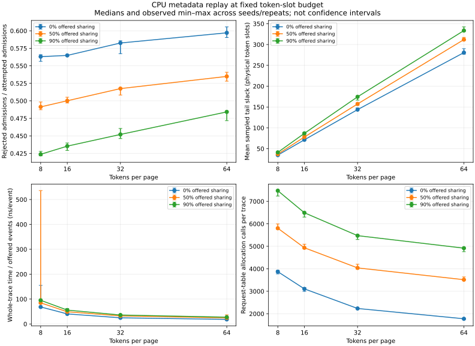
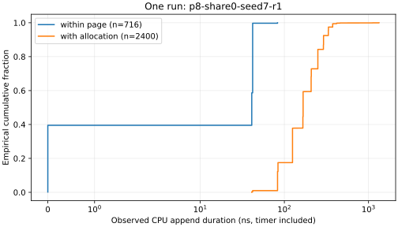

# EXP-0002: page size, prefix sharing, and CPU metadata cost

Date: 2026-10-24, America/Los_Angeles. Status: measured local CPU screening
experiment; not an optimization comparison or GPU result. Engineering log entry
0008 and [ADR 0005](../decisions/0005-cpu-workload-measurement.md) record the design.

## Question and competing costs

Under the same 4096-token-slot pool and offered event trace, do larger pages
reduce request-table work while wasting more slots? Does sharing a retained
complete prefix improve admission enough to offset the prefix owner's capacity?
The implementation is unchanged across policies. The no-sharing configuration
is a capacity-policy baseline, not an alternate allocator implementation.

Protocol: 32 slots, prompts 1..1024, appends 1..16, 128-token retained prefix
when enabled; P=8/16/32/64; offered sharing 0/50/90%; seeds 7/17/29; three
fresh-process repetitions per seed/config. Each process offers 20,000 events
with up to 2048 warmup events. Jobs run serially in order shuffled with seed 123.
There are 108 runs and 2,160,000 individually timed offered events, including
skipped/rejected events. Three seeds are independent capacity workloads;
repeating each seed does not add independent capacity evidence.

## Timing failure discovered in EXP-0001

The initial 108-run sweep exposed clock granularity: many event durations and
the empty-control median were zero. One control histogram contains 6,621 zeros,
1,127 observations at 41 ns, and 2,252 at 42 ns. Zero-duration events are not
zero-cost operations. EXP-0001 remains retained locally; its capacity results
are valid, but interpreting its shortest timings as precise latency is
inconclusive. No outliers or zero observations were silently discarded.

Added zero-duration counts, the complete timer-control histogram, and a third
replay timed with only two clock reads. Its mean includes every offered event,
including checksum accumulation, dispatch, skips, failures, and PMR counters;
it is not successful-operation latency. The diagnostic replay still checks every
event against the individually timed pass. All 108 admission/memory/allocation
counts and offered-trace hashes match EXP-0001 exactly after this instrumentation
change. Repeating the experiment was justified by the new timing boundary.

## Environment and correctness

Local ARM64 macOS 26.6.2; Apple Clang 17.0.0; CMake 4.4.4; Ninja 1.13.2;
Release `-O3 -DNDEBUG`, C++17. Exact CPU model was unavailable through the
restricted sysctl query. No core affinity, clock controls, temperature sampling,
or exclusive-host guarantee. No performance counters are used. Host activity
and timer instrumentation limit generalization.

The full 67-check suite passed in Debug, Release, and UBSan without compiler
warnings. It includes 14 new C++ tests and one executable JSON/CSV integration
test; 32,000 new independent-model unshared transitions plus 8,000 shared
transitions complement the previous tests. After timing refinement, the changed
benchmark rebuilt and its output-contract test passed in all three modes. A
fresh Debug build from the final project directory also passed all 67 checks
without warnings.
ASan remains unresolved from the earlier host startup investigation. No CI or
GPU validation is claimed.

## Observed results

Each row is a median across nine runs (three seeds × three repetitions).
Whole-trace timing also shows the observed min/max. Ranges are not confidence
intervals. Tail slack means are sampled by event index, not time-weighted.

| Tokens/page | Offered sharing | Rejection fraction | Mean sampled tail slack (slots) | Request-table allocation calls | Whole-trace ns/offered event: median [min, max] |
|---:|---:|---:|---:|---:|---:|
| 8 | 0% | 0.5631 | 34.56 | 3871 | 68.37 [66.88, 155.01] |
| 8 | 50% | 0.4914 | 37.05 | 5804 | 84.84 [81.55, 535.93] |
| 8 | 90% | 0.4237 | 41.12 | 7474 | 95.09 [91.67, 99.17] |
| 16 | 0% | 0.5649 | 71.35 | 3106 | 40.39 [38.69, 41.65] |
| 16 | 50% | 0.5002 | 77.97 | 4935 | 49.04 [48.54, 51.39] |
| 16 | 90% | 0.4354 | 86.80 | 6492 | 55.76 [53.77, 62.03] |
| 32 | 0% | 0.5826 | 143.78 | 2234 | 24.77 [24.69, 25.64] |
| 32 | 50% | 0.5175 | 157.39 | 4039 | 32.41 [30.84, 38.10] |
| 32 | 90% | 0.4521 | 174.50 | 5474 | 36.01 [34.45, 38.31] |
| 64 | 0% | 0.5971 | 280.69 | 1776 | 18.39 [17.91, 19.52] |
| 64 | 50% | 0.5349 | 311.89 | 3514 | 24.43 [23.70, 36.69] |
| 64 | 90% | 0.4842 | 333.55 | 4917 | 27.29 [26.76, 27.89] |



At P=16, moving from 0% to 90% offered sharing changes median admission rejection
from about 56.5% to 43.5%, while request-table allocations increase from 3,106 to
6,492 per trace. More requests succeed and prefix-sharing itself builds metadata;
we did not isolate how much each mechanism contributes. At 0% sharing, mean
sampled tail slack rises from about 34.6 slots at P=8 to 280.7 at P=64. These are
properties of this offered trace and retained-prefix policy, not universal bounds.

The fastest-looking aggregate configurations also reject more work. Do not turn
the aggregate time differences into an allocator speedup. One retained run,
`p8-share50-seed29-r2`, measured 535.93 ns/offered event, far above its group's
84.84 ns median. The host was not isolated; the cause is unresolved. Its result
remains in the table, data, and chart.



This one-run CDF contains 716 within-page and 2,400 allocating append samples.
The quantized, often-zero within-page measurements cannot support a fine-grained
latency claim. The [lossless histogram](data/0002-append-histogram.csv) preserves
all values/counts used here. No p99 is reported for these undersized groups.

## Reproduction and provenance

Follow [the benchmark contract](../BENCHMARKS.md). The exact sweep is:

```sh
python3 scripts/run_allocator_experiments.py   --binary build/release/allocator_bench --output artifacts/exp-0002   --events 20000
python3 scripts/plot_allocator_experiments.py artifacts/exp-0002
```

The plotting command requires the pinned optional plot dependency. Use a new
output directory for another run. [Per-run data](data/0002-runs.csv) supports the
summary chart; [provenance](data/0002-provenance.json) records source/binary hashes,
configuration, artifact hashes, environment, and plotting package versions.
Full event CSVs, sampled memory CSVs, commands, CMake cache, timing controls, and
logs remain in the original local ignored artifact directory. A fresh clone has
compact results and reproducer code, not the full raw corpus or local blog.
Source hashes describe the working implementation used for measurement; the
recorded base commit precedes chunk 04. Reproduce by matching the source hashes,
not by checking out that base commit alone.

## Decision, limits, and cost

Keep the existing correctness-first allocator. Candidate-table growth has a
measurable host-allocation cost; a pre-reserved table or in-place journal is a
separate paired experiment, not a change justified by these data alone. Do not
select a GPU page size from CPU timing. Before GPU work, finish the sanitizer
validation on a functioning host and isolate primitive timing/alternative table
strategies where useful. The Phase 1 gate remains partly open.

This session provisioned no remote compute or storage. Recorded infrastructure
spending remains $0. Charts use an isolated local plotting environment. An initial
font-cache permission diagnostic did not prevent rendering; both charts were
visually inspected. No benchmark data were discarded because of that diagnostic.
