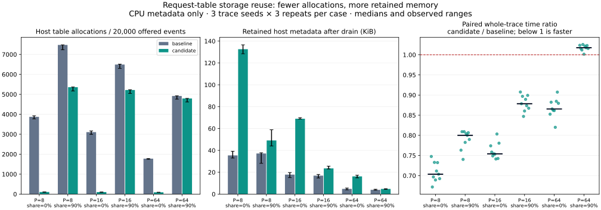

# EXP-0003 — Request-table reuse versus full candidate reconstruction

Date: 2026-10-25, America/Los_Angeles. Status: measured; local and Linux correctness/sanitizer checks passed. Engineering log: entry 0010.
Decision: [ADR 0007](../decisions/0007-request-table-growth.md).

## Hypothesis and falsification

Rebuilding every table on page growth incurs avoidable PMR calls and moves.
Reusing geometrically grown storage should reduce those calls, especially across
request-slot resets, at a cost in retained host memory. It may not improve time
when prefix sharing dominates and few growth allocations are removed. Unchanged
allocation counts would disprove the allocation hypothesis; mismatched logical
outcomes or physical accounting would invalidate the timing comparison entirely.

## Baseline, candidate, and correctness

Baseline: commit `7e820180a242b39a2a2082f6a28a395d207fef7d`, full candidate tables.
A Release executable was compiled and frozen before source edits. Candidate: [`d0ad3a8`](https://github.com/BIN0806/GPU-Inference/commit/d0ad3a8b459fa52ce1cfa16964a7b783b485eafb),
suffix rollback and geometric host storage growth, with exact source and binary
hashes in [provenance](data/0003/provenance.json). The C++ benchmark and workload
code are byte-identical between builds. The candidate source diff is preserved
in ignored raw artifacts; the implementation commit also contains the final code.
No algorithm dispatch, alternate trace generator, or new timing path was added.

The logical ownership contract is unchanged. Failed acquisition may now retain
larger host capacity; this is explicitly permitted and tested. Local Debug and
Release pass 73 checks each; UBSan passes 74. Four new C++ tests cover spare
capacity, logarithmic allocations/reset reuse, all suffix failure positions with
shared ownership, and preflight ordering. The independent model tests remain
unchanged (1,264,000 decisions per full suite). Additional Python checks reject
mismatched work/memory and instrumented Release baselines. All five modes in [Linux CI](https://github.com/BIN0806/GPU-Inference/actions/runs/40232916754) pass
(73 normal / 74 sanitized checks); this experiment does not resolve the Mac's ASan runtime issue.

## Environment and protocol

Apple M3 Pro, ARM64 macOS 26.6.2, Apple Clang 17 (`clang-1700.6.3.2`), libc++ `_LIBCPP_VERSION`
200100, CMake 4.4.4, Ninja 1.13.2. Both binaries used Release `-O3 -DNDEBUG`, C++17,
no sanitizer or LTO flags. The comparison script used Python 3.14.0; CMake selected
Python 3.14.8 for tests. Optional charts use the existing pinned Matplotlib 3.10.8
environment. Compiler/cache/binary hashes and full command order are retained.
No pinned core, fixed frequency, thermal telemetry, or exclusive-host control.
Observed ranges are descriptive, not confidence intervals or population guarantees.

54 adjacent pairs / 108 fresh-process runs: page tokens 8/16/64 × offered sharing
0/90% × seeds 7/17/29 × 3 repeats. Every run has 20,000 offered events, 4096 pool
token slots, 32 request slots, max request 1024 tokens, prefix 128, sample interval
128. Pair order and within-pair variant order are randomized with seed 601.
The [runner protocol](../BENCHMARKS.md#comparing-request-growth-implementations-chunk-06)
explains the exact command, provenance, timeouts, and build restrictions.

The unchanged harness warms up 2048 events separately. It records individually
timed operations, a diagnostic replay, and a whole-trace replay with two clock
reads. Reported times come from the latter, including dispatch, PMR counters,
contract checks, skips and rejected work; construction, diagnostics, file output,
and drain are outside this interval. These are means per **offered CPU metadata
event**, not p99, successful append latency, model tokens/s, or GPU decode time.
Do not use the individually timed nanosecond groups to establish this speedup.

Before accepting a pair, the runner compares configurations, every offered event
and outcome, all outcome totals, and every sampled physical-memory CSV row.
**All 54 pairs matched.** No run was discarded or rerun for favorable timing.
Physical live/free/shared pages, modeled KV bytes, and tail slack are identical
between variants for a given workload. Differences below are host table storage
and execution cost, not improved KV capacity.

## Results

| Page tokens | Offered sharing | PMR calls, base → candidate | Retained bytes, base → candidate | Mean ns/event, base → candidate¹ | Paired time ratio, median [min, max] |
|---:|---:|---:|---:|---:|---:|
| 8 | 0% | 3,871 → 106 | 36,288 → 135,768 | 67.47 → 46.78 | 0.703 [0.672, 0.748] |
| 8 | 90% | 7,474 → 5,357 | 38,040 → 50,280 | 96.76 → 76.31 | 0.800 [0.740, 0.809] |
| 16 | 0% | 3,106 → 102 | 18,288 → 70,608 | 39.34 → 29.66 | 0.754 [0.741, 0.803] |
| 16 | 90% | 6,492 → 5,216 | 17,304 → 24,096 | 55.61 → 49.00 | 0.878 [0.847, 0.908] |
| 64 | 0% | 1,776 → 91 | 4,896 → 16,608 | 18.56 → 16.38 | 0.865 [0.820, 0.907] |
| 64 | 90% | 4,917 → 4,792 | 4,032 → 4,872 | 27.24 → 27.71 | 1.018 [1.001, 1.025] |

¹ Each entry is the median of nine whole-trace mean observations. The ratio
column is the median of paired ratios, not the ratio of those two medians.
Allocation and byte columns are medians across those same runs. Repeats within
a seed have identical deterministic counters; they add timing observations, not
new capacity workloads. All individual observations are in [pairs.csv](data/0003/pairs.csv).



Bars show medians and observed min/max; points show all nine paired time ratios
per case. Retained bytes are measured by the request-table PMR resource after
all page owners drain, before table destruction. They are not RSS or device
memory. `peak_live_bytes` and total requested bytes are also preserved in the
CSV; transient old/new vector coexistence can affect the peak.

## Interpretation and decision

At P=16 without sharing, median calls fell from 3,106 to 102 (about 96.7% fewer),
and the median paired time ratio was 0.754 (about 24.6% less time). Retained host
metadata rose from 18,288 to 70,608 bytes, about 3.86×. Five of six cases show a
lower median whole-trace time. **P=64 with 90% offered sharing regresses:** ratio
1.018, with every observed paired ratio between 1.001 and 1.025. That small
regression is retained, not dismissed as noise or hidden in an overall mean.

Reduced PMR work is an implementation-supported explanation for the improvements,
but this experiment does not isolate relocation, allocation, branch overhead,
and cache effects causally. At high sharing, the unchanged prefix transaction
still allocates a candidate table, replacing storage that reset retained. Thus
storage reuse helps less. The exact cause of the small timing regression remains
unprofiled. No extrapolation to another compiler, CPU, request distribution, or
real model is justified.

Keep this implementation for the current laboratory: it reduces repeated growth
work, preserves logical rollback, and makes the host-memory cost observable.
Keep the baseline revision and experiment reproducible for memory-sensitive
comparisons. Do not add a shape-dependent dispatcher based on six cases. If
retained metadata becomes a real constraint, compare a quiescent trim policy or
bounded up-front reservation as a separate change. A production workload heavily
matching the regressing case may reasonably prefer the baseline.

## Evidence, reproduction, and cost

Raw directory: `artifacts/experiments/EXP-0003-request-growth/` (ignored).
It contains per-run JSON/CSVs, logs, both CMake caches/compilation databases, the
source diff, manifests, and chart outputs. Public provenance records raw file
checksums and both source inventories; it excludes the local blog. The public
SVG has trailing spaces normalized; raw data values are unchanged. The chart
was rendered and visually inspected. To regenerate from raw results:

```sh
python3 scripts/plot_allocator_comparison.py artifacts/experiments/EXP-0003-request-growth
```

To rebuild the baseline, use the stated commit in a separate checkout and an
unsanitized Release build. Generate its source hash manifest before modifying
that checkout, then run the comparison command in the benchmark protocol. The
recorded hashes identify this measured build; a rebuilt binary can differ due
to paths, tool versions, or reproducibility metadata.

Cost: $0. No GPU, paid compute, storage, or persistent cloud resource was
provisioned. Linux CI remains subject to the existing public standard-runner
cost boundary. No throughput or latency promise is made for a serving system.
