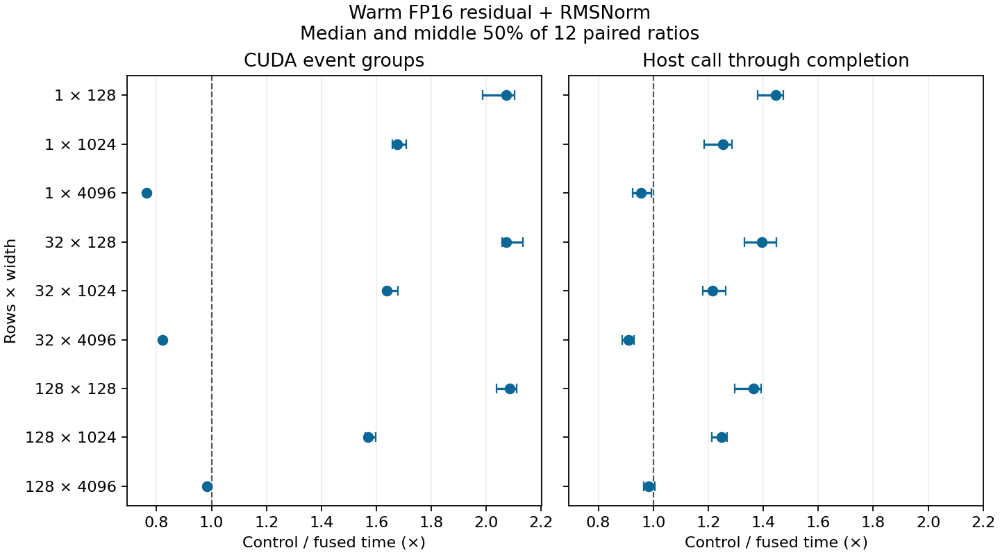

# Native residual + RMSNorm on one L4

## Question and controls

For a warm FP16 working set, where does a one-block-per-row fused operation
reduce stream time and host-visible latency? The control spreads residual
addition across a separate flat grid. Fusion removes a launch and a logical
read of the rounded residual, but moves the addition into the row's block.
Either variant can win, particularly at one row.

Both variants run from the same executable on GPU 0 and return both rounded
residual and normalized output. Precision, weights, epsilon, buffers, stream,
reduction tree, and final weighted pass match. The library uses explicit
round-to-nearest operations and builds with FMA contraction and FTZ disabled.
The first pass of the fused variant reads the FP16 cast back into FP32 for
the denominator. [Design decision](../decisions/0011-fused-row.md).

## Measurement protocol

Use FP16 rows 1, 32, 128 and widths 128, 1024, 4096. For each shape allocate
once, populate deterministic bounded inputs, warm each variant 24 times, and
synchronize. Alternate the order of the variants on successive pairs, with
six pairs in each order. Each sample records two distinct intervals.

- CUDA events bracket 64 operations submitted down the prevalidated launch
  path; one operation is one fused launch or two control launches. Report
  elapsed milliseconds × 1000 / 64 in microseconds. The stream can run dry
  while the host submits work, especially at small shapes.
- A separate host steady-clock interval begins immediately before one public
  call and ends after stream synchronization. It includes pointer/device
  checks, submission, and completion.

The experiment excludes initialization, H2D/D2H copies, allocations, compilation,
and sanitizers from the intervals. It reuses the same buffers for both paths.
The largest shape occupies roughly 4 MiB across the four FP16 activation
buffers, plus weights. A cold streaming workload may behave differently. No
hardware counter, clock lock, cache flush, graph replay, or co-tenancy control
was used. The setup and command durations are retained in the session report.

## Results from November 26, 2026

One Modal L4 (23,034 MiB reported, driver 620.70.06) built the candidate for
sm_89 with nvcc 12.8.93 and GCC 13.3.0. Both variants passed 34 smoke and
218 full FP16/FP32 cases with bitwise residual checks. Each passed the same
per-element absolute-plus-relative output tolerances. The fused smoke matrix
also passed memcheck, racecheck, and synccheck. The run used the pinned CUDA
image and a clean source tree. [Checks and hashes](../validation/0011-modal-l4.json).

The time columns give medians in microseconds. Stream observations are means
over 64 calls. Host observations time individual calls. A ratio is the median
of 12 within-pair control/fused ratios. Brackets give their inclusive 25th and
75th percentiles, rounded to two decimals. A ratio above one favors fusion.

| Rows × width | Stream control / fused (µs) | Paired ratio [IQR] | Host control / fused (µs) | Paired ratio [IQR] |
|---|---:|---:|---:|---:|
| 1 × 128 | 7.26 / 3.55 | 2.07 [1.99, 2.10] | 14.82 / 10.24 | 1.45 [1.38, 1.47] |
| 1 × 1024 | 7.35 / 4.38 | 1.68 [1.66, 1.71] | 15.65 / 12.50 | 1.25 [1.18, 1.29] |
| 1 × 4096 | 8.99 / 11.79 | 0.76 [0.76, 0.76] | 19.66 / 20.20 | 0.96 [0.92, 0.99] |
| 32 × 128 | 7.29 / 3.49 | 2.07 [2.06, 2.13] | 14.36 / 10.52 | 1.39 [1.33, 1.45] |
| 32 × 1024 | 7.25 / 4.42 | 1.64 [1.63, 1.68] | 15.61 / 12.78 | 1.22 [1.18, 1.26] |
| 32 × 4096 | 9.74 / 11.87 | 0.82 [0.82, 0.82] | 18.94 / 20.62 | 0.91 [0.89, 0.93] |
| 128 × 128 | 7.34 / 3.55 | 2.08 [2.04, 2.11] | 14.69 / 10.84 | 1.36 [1.30, 1.39] |
| 128 × 1024 | 7.27 / 4.64 | 1.57 [1.56, 1.60] | 15.97 / 12.83 | 1.25 [1.21, 1.27] |
| 128 × 4096 | 11.82 / 12.03 | 0.98 [0.98, 0.98] | 20.67 / 21.00 | 0.98 [0.97, 1.01] |



For widths 128 and 1024 the fused stream path won at all three batch sizes.
At width 4096 it lost at all three. At one row × 4096, fusion increased median
stream time from 8.99 to 11.79 µs. With 128 rows the width-4096 penalty narrowed
to 11.82 versus 12.03 µs, and the host ratio's interquartile range crossed one.
For narrow rows, removing a submission also helped less on the host boundary
than on the stream boundary. [All 216 raw observations](data/0004/timings.jsonl).

The control distributes the add across the whole grid. The fused path serializes
32 columns per thread at width 4096, using only one block when M=1. That work
distribution is one plausible contributor to the regression. The FP16 fused
kernel used 26 registers per thread, the control's norm used 27, and both used
512 bytes of shared memory. The compiler reported zero spill loads and stores
for both. Those facts make a spill explanation unlikely for these binaries.
They do not quantify memory traffic or execution stalls.

Keep both variants selectable. One warm sweep on one GPU supports a targeted
follow-up at width 4096. Try 256 threads in the fused block, keeping the scalar
layout and matched harness, then rerun the oracle because the reduction order
changes. Repeat on independent sessions and a larger working set before
choosing portable dispatch thresholds. Framework comparisons remain open.

## Reproduction

The tested revision is `10150b107d84fe1c2adc70eb57c0b1d544bc0922`. From that
checkout on a provisioned L4, run the command below. The output path must be new.

```sh
python3 scripts/check_rmsnorm_cuda.py --run-gpu --cuda-arch 89 \
  --implementation fused --paired-timing --output artifacts/repro-0004
```

To use Modal, set `KVLAB_FUSED_REVISION` to the exact revision above and follow
the [L4 instructions](../MODAL.md#run-the-fused-comparison). To reproduce the
table from the published raw samples, run from the evidence checkout:

```sh
python3 scripts/summarize_rmsnorm_pairs.py docs/experiments/data/0004/timings.jsonl
```

Adding `--plot path/to/ratios.png` regenerates the figure using the
[plotting environment](../../scripts/requirements-plot.txt).
